# Figma ⇄ Wecra visual comparison — group A (live captures), 2026-10-18

Detection only: nothing in the product was changed. Each section below covers one Figma capture. It shows the
side-by-side image (Figma left, Wecra right, same scale), the state that was recreated, and numbered differences
marked **Major**, **Minor** or **Cosmetic**. A `-diff.png` next to each compare image is a difference blend (black
where both agree). Use it only where the layouts line up.

## Scope and method

* **Captures:** all 75 Figma images of group A:
  * `docs/research/figma/live/img/` (46 images). They are kept out of git and were read from the main checkout.
  * `docs/research/figma/live/behaviour/img/` (29 images).
  * None of them are our own screenshots. Every one is live Figma: the web app for `img/` and most of `behaviour/`, and
    the owner's desktop-app screen recordings for `autolayout-drag-*`.
* **Wecra:**
  * Run with `npm run web -- --mode demo --port 5210` and headless Chrome through Playwright (SwiftShader GL).
  * Dark theme, except the `autolayout-drag-r2-*` frames, which use the light theme like the recording.
  * Opened on `?editor&doc=capture`, the demo fixture built from the same capture page.
  * View › Additional labels was on, as it was in the live captures: `propertyLabels` and `railLabels`.
  * U.S. keyboard layout, as editor-shot uses. Without it the host Mac's Turkish layout turns `⇧'` into `⇧Ö`, `⌘\`
    into `⌘I`, and so on.
* **Scripts:** in `tools/`, throwaway.
  * `shoot.mjs`: the states.
  * `compose.mjs`: the compare and diff images.
  * `measure.mjs`: live's own `dumpPanel.js` / `dumpPopups.js` run on Wecra and diffed with live's `compare*.mjs`.
    The output is in `measure/*.diff`. Most "MISSING/DIFF" lines there are matching artefacts: tooltip text, and live
    reporting a field's box where ours reports the input. Only the real ones are quoted below.
  * `zoom.mjs`: pixel crops used for measuring.
  * `probe.mjs`: finds the size-label pill.
  * `fontcheck.mjs`: checks that the fonts load.
* **Fonts verified:**
  * `tools/fontcheck.mjs` logged HTTP `200` for `@fontsource-variable/inter/files/inter-latin-wght-normal.woff2`. It came
    from this worktree's own `node_modules` (`npm ci` was run here) and was served by the same Vite server.
  * It also logged `200` for the engine's `src/engine/fonts/Inter-3.19.ttf`.
  * `document.fonts` reports `Inter Variable … loaded`, and the panels' computed family is
    `"Inter Symbols", "Inter Variable", Inter, …`.
  * No fallback font was involved.
* **Scale:**
  * Live canvas captures are pane crops at different device scales. The scale was worked out from the size-label pill
    (live 1× pill ≈ 15–16 px high, "320 × 200" ≈ 55 px wide) and from the menu widths in the dumps (context menu =
    200 CSS px).
  * Scales used:
    * 1.0: arrow, layout guide, group, multi, section, text, rotated star
    * 1.08: the 480 × 862 crops (grid compact pills, row track, context menus)
    * 1.12: instance / main component
    * 1.15: component set
    * 1.47–1.53: auto layout
    * 1.52: star / polygon
    * 1.58: grid pills
    * 1.7: ellipse
    * 1.72: rect
    * 1.8: high-res panel
    * 2.0: grid frame
    * 0.9: main menu
    * 0.556: the 800 × 500 full-UI images
    * 0.91: autolayout-drag
  * Wecra was shot at the same CSS window and device scale, so the images are pixel-comparable.
  * Placement is by camera only, so expect ±2–6 px offsets.
* **Not counted as differences:**
  1. **The fixture's own content.**
     * Live's `Icon/Star` is a yellow square, ours a star.
     * The chip variants are grey/teal in live, blue in ours.
     * The group's children are placed differently.
     * The Layers order and which rows are expanded differ.
     * Live's text reads "Hello Figma text"; it was set the same in Wecra for the text shots.
     * Page 3 and the Behaviour page were added to Wecra by script.
     * The variables are Wecra's `&doc=variables`, not live's `Tokens`.
  2. **The live captures' colour shift.**
     * Live `img/` canvas captures are desaturated by the capture's colour profile: `#E5664D` reads ≈ `#D77058`, the
       selection blue ≈ `#4A8DE8` instead of `#0D99FF`.
     * Canvas colours are therefore not compared; the panels' colours come from the dumps instead.
  3. **Timing.** Moments in the middle of an animation, such as a sibling caught mid-slide, cannot be timed exactly
     from a headless run. They are noted, not counted.

## Totals

Each global item is counted once. **Ours** items are counted separately.

| Severity | Count |
|---|---|
| Major | 10 |
| Minor | 44 |
| Cosmetic | 22 |
| Ours (consistency findings) | 6 (Minor 2, Cosmetic 4) |

## Global differences (seen in many captures, counted once)

* **G1 [Minor] The size-label pill is about 10 % wider.**
  * At 1×, "400 × 300" is ≈ 58 px in live (text ≈ 50) and 64 px in Wecra (text ≈ 56). "240 × 100" is 54 → 62 and
    "184 × 29" is 49 → 55.
  * The height is the same (≈ 16–17 px).
  * Live sets the "×" with narrower spaces. The same goes for Hug/Fill labels: "232 Hug × 72 Hug" is 146 → 153 px
    at 1.53×.
* **G2 [Minor] No AI sparkle button by the selection.** Live draws its AI (sparkle) button outside a selected layer's
  top-right corner. Wecra never does. Seen in:
  * rect-hover-radius
  * autolayout-child-selected
  * grid row pill
  * autolayout-drag 01 / 05 / 08
  * r2-07
  * minimize-with-selection
  * move-big-layer
* **G3 [Minor] Corner-radius rings on frames and instances.**
  * Wecra draws four corner-radius rings on a selected, hovered frame or instance: AL_horizontal, AL_grid, Button and
    its instance, the dropped layer.
  * No live capture shows rings on a frame or instance. Live shows them on the plain rectangle only.
* **G4 [Cosmetic] Text line boxes are 1 px taller.** Every text line box in menus and panels is 14 px high in Wecra
  against 13 px in live (11 px Inter). This shows on every row of `measure/*.diff`. Rows and positions still line up.
* **G5 [Minor] No dotted sibling outlines.** Right after a drop, while the parent auto-layout frame is hovered, live
  outlines the other children with dotted lines (`autolayout-drag-08`, `-r2-07`). Wecra does not.
* **G6 [Minor] The pixel grid is too strong.** It is clearly visible at 300 % and ≈ 370 %, and at 800 % its lines are
  much brighter than live's.
  * Live: at 300 % it is invisible in the capture (behaviour/keys.md: "faint"), and the light-theme recording at
    ≈ 370 % shows none.
  * See `pixel-grid-300`, `pixel-grid-800` and every `-r2-` frame.

## Ours — no Figma original

These are judged only for consistency with UI3.

* **O1 [ours, Cosmetic] Brands tab.** The rail has a **Brands** tab (Studio) between Assets and Tools. Its icon,
  label, spacing and states match the Figma tabs.
* **O2 [ours, Cosmetic] AI balance row.** The Figma menu has an **AI balance** row after Libraries. It makes the menu
  194 × 468 instead of live's 444 (`measure/popup-main-view.diff`). Its row type and spacing match.
* **O3 [ours, Cosmetic] Extra View rows.** View has **Switch to Motion** and **Social** between Switch to Draw and
  Switch to Dev Mode.
  * The submenu grows to 835 px and has to start at y 57 (live: 105).
  * The rows themselves are consistent.
* **O4 [ours, Minor] Status pill text is too small.** The frame header has a **◌ Status** pill at 97, 16 (51 × 16).
  Its text is **9 px**/450 `#ffffffb2`, below UI3's 11 px chrome text. It also sits where live's header has only
  `</>`, component and ⋯ buttons, and crowds them (`measure/panel-autolayout-grid.diff`).
* **O5 [ours, Cosmetic] Export tabs.** Export always has a **Static / Animated** tab strip (216 × 24), even with nothing
  to export. Live's Export section is just the header with "+".
* **O6 [ours, Minor] The wider toolbar moves everything that hangs off it.** The mode switch's extra modes make the
  bottom toolbar wider, so it shifts left by 15 px. Everything that hangs off it moves too:
  * Shape tools menu at x 596 instead of 611 (`measure/popup-shape-tools-menu.diff`).
  * Actions palette at x 441 instead of 456.

---

## img/ — canvas captures

### canvas-arrow-line-selected
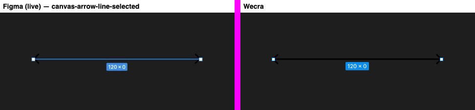
State: Arrow selected (`7:65`), 1×, UI hidden.
1. **[Minor] The line is not highlighted.** Live draws the selected line itself in the selection blue, over its black
   stroke. Wecra keeps it black and draws only the two endpoint squares.
2. G1 applies: the pill is "120 × 0", 42 → 48 px.

### canvas-autolayout-child-selected
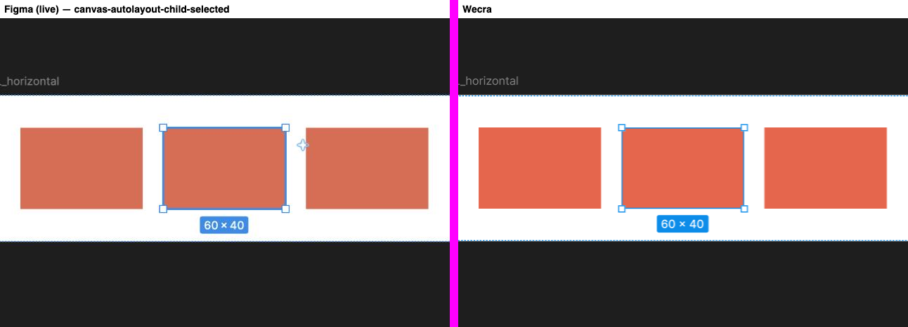
State: AL_horizontal_item2 selected; the parent shows a dashed outline.
* The parent's dashed box, handles and position match. Only G1 and G2 apply.

### canvas-autolayout-selected-hover-gap
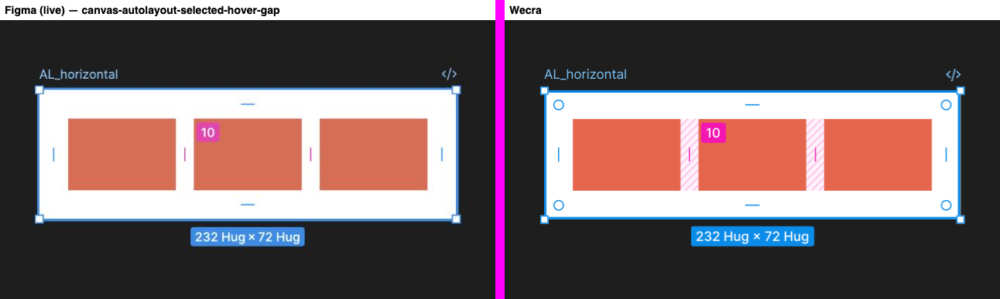
State: AL_horizontal selected, pointer on the first gap.
1. **[Minor] Hatched gaps.** Wecra fills **both** gaps with a pink hatch. Live shows only the pink gap bars and the
   "10" badge.
2. G3 and G1 apply.

### canvas-autolayout-selected-hover-padding
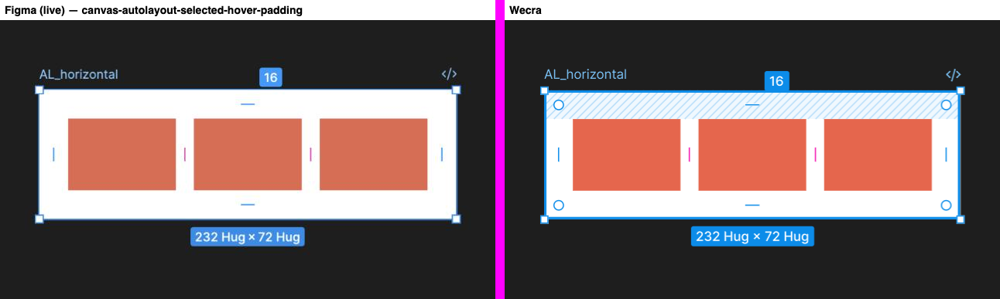
State: AL_horizontal selected, pointer on the top padding bar.
1. **[Minor] Hatched padding.** Wecra hatches the whole top padding band and draws the "16" badge. Live draws the badge
   only.
   * In `grid-frame-selected-full-ui` live does hatch a hovered padding, so this may depend on the pointer spot.
2. G3 applies.

### canvas-hover-outline-nothing-selected
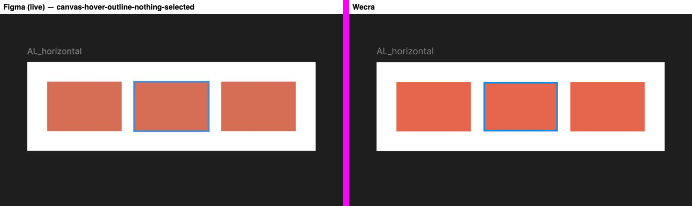
State: nothing selected, AL_horizontal_item2 hovered. No difference: a 2 px blue outline and a grey frame title in
both.

### canvas-component-set-selected
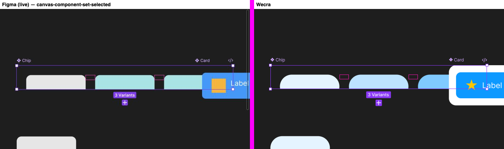
State: the Chip set selected.
1. **[Cosmetic] Labels sit 2 px higher.** The "❖ Chip" / "❖ Card" labels and the purple `</>` sit ≈ 2 px higher in
   Wecra.
2. Everything else matches: the "3 Variants" pill, the purple "+", the pink gap boxes and the purple outline.

### canvas-ellipse-selected-arc-handle
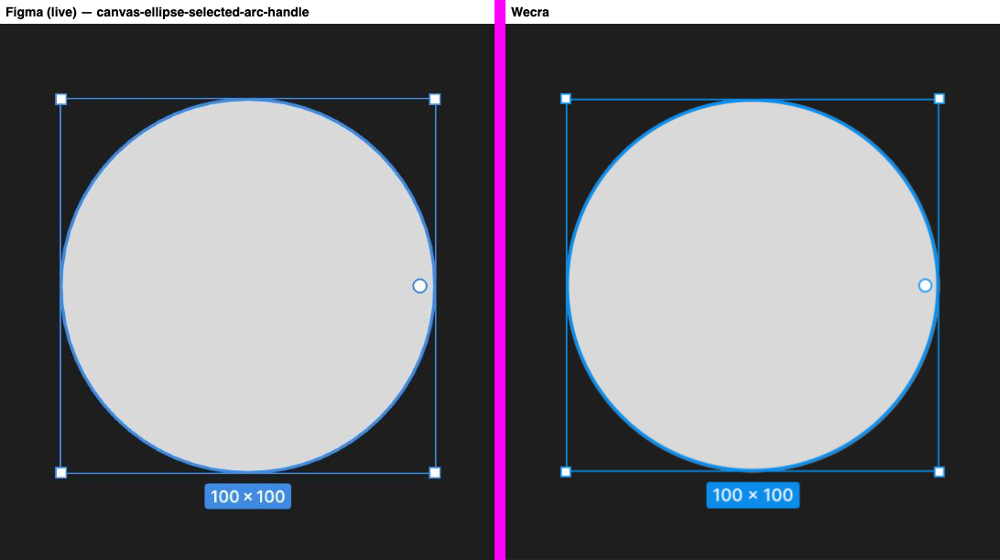
State: Ellipse selected and hovered. No difference beyond G1. The arc ring at the right edge, the handles and the
outline match.

### canvas-frame-layout-guide-columns-unselected
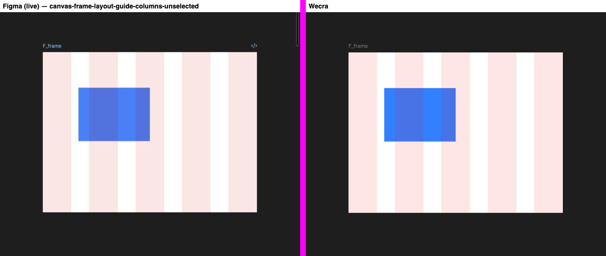
State: F_frame with a 5-column Stretch guide (gutter 20, red 10 %), not selected.
1. **[Minor] Title and </> when not selected (possibly a state mismatch).** Live shows the frame title in **blue with
   the `</>`** although nothing is selected, which looks like a hover. Wecra (pointer away) shows a grey title and no
   `</>`.
2. The columns line up exactly.

### canvas-frame-selected-with-layout-guide
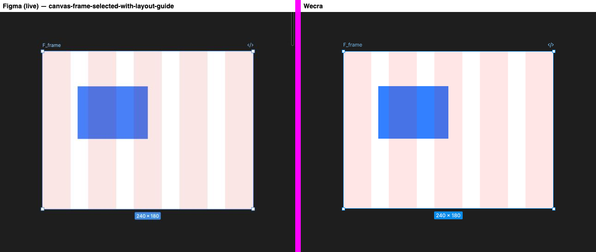
State: F_frame selected, with the guide. No difference beyond G1.

### canvas-grid-frame-selected
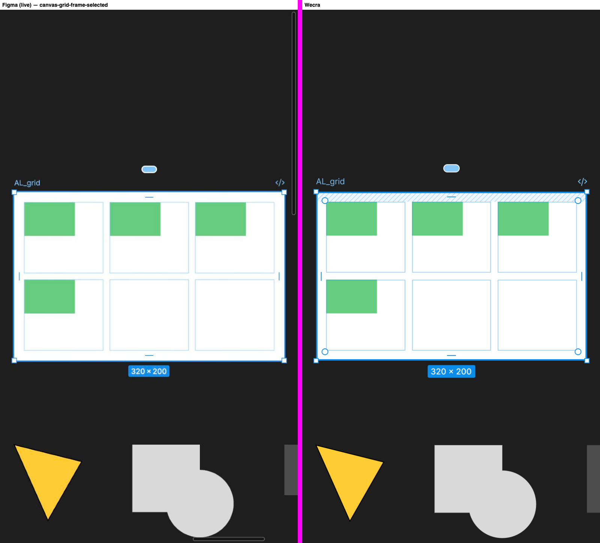
State: 2× (400 × 718 pane), AL_grid selected, pointer in the top padding left of its bar.
1. **[Minor] Padding hatch with the column pill.** Wecra hatches the top padding while showing the column pill. Live
   shows only the compact column pill.
2. **[Cosmetic] Scrollbars.** Live shows the canvas scrollbars (right and bottom). Wecra shows none in a still frame.
3. G3 applies.

### canvas-grid-hover-cell-compact-pills
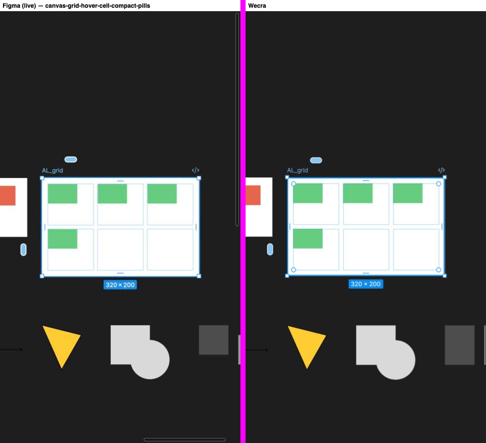
State: 1.08×, AL_grid selected, pointer in cell (col 1, row 2).
* The compact top and left pills, the cell outlines and the padding bars match. Only G3 applies.

### canvas-grid-hover-column-track-pill
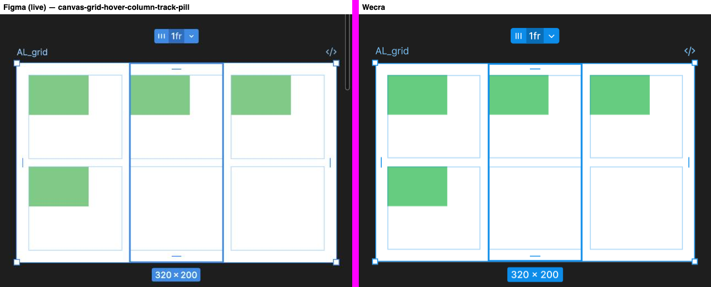
State: column 2's pill hovered (expanded `||| 1fr ⌄`), column outlined.
1. **[Cosmetic] Chevron shade.** Wecra's chevron segment is a darker blue than its label segment. Live's pill is one
   blue.

### canvas-grid-hover-row-track-pill
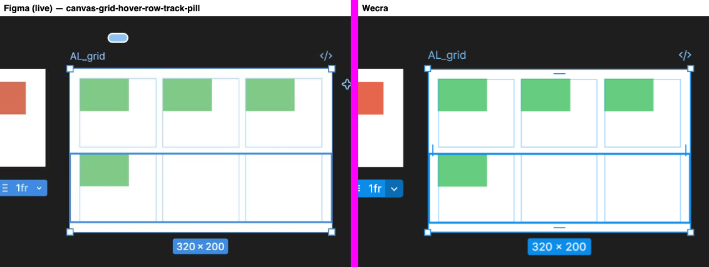
State: row 2's pill hovered.
1. **[Minor] Column pill hidden.** Live keeps the compact column pill above the frame while the row pill is hovered.
   Wecra hides it.
2. **[Minor] Extra marks.** Wecra keeps the top and bottom padding bars and adds small tick marks at both ends of the
   row's top line. Live shows neither.
3. G2 applies (live's sparkle).

### canvas-grid-hover-top-pill
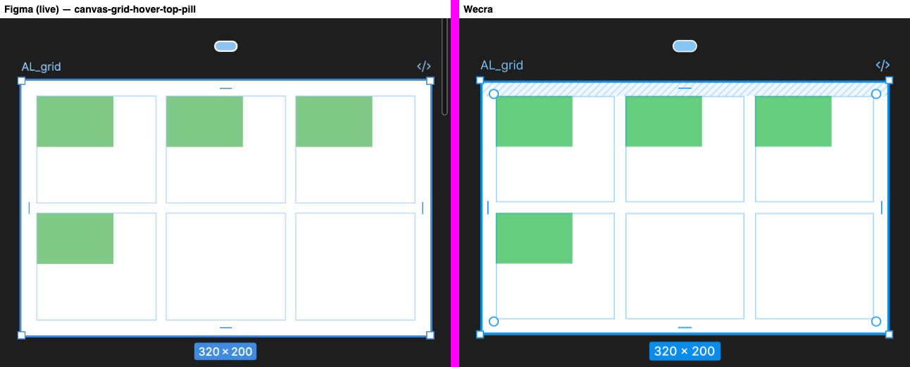
State: pointer in the top padding over column 2 (off the bar). Live shows the compact pill only.
* This repeats canvas-grid-frame-selected #1 (Wecra hatches the padding band); not counted again. G3 applies.

### canvas-grid-row-track-selected
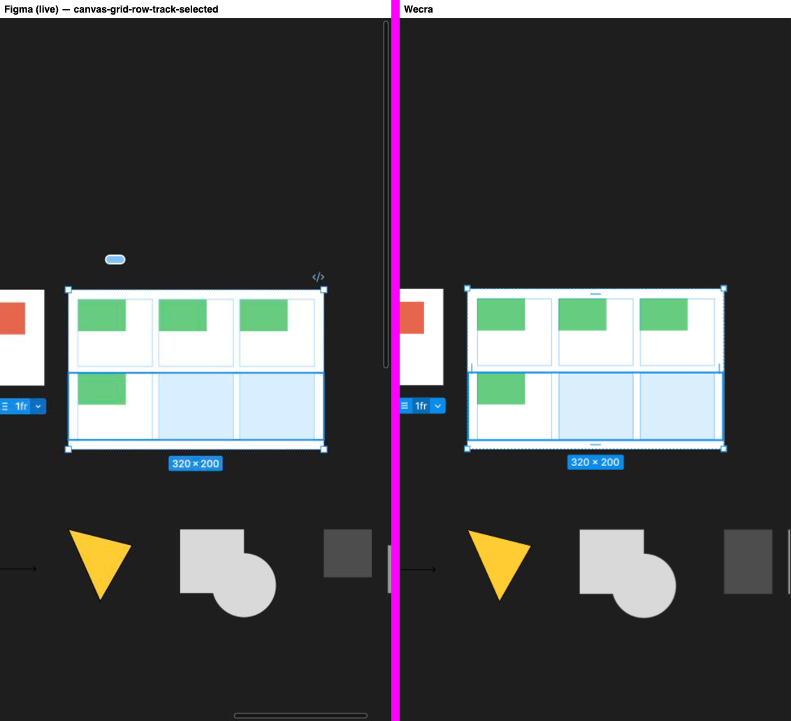
State: row 2 selected through its pill. The empty cells are light blue and the frame is dashed in both.
1. **[Minor] Extra chrome.** Wecra still draws the top and bottom padding bars and the tick marks at the row line's
   ends. Live hides them while a track is selected.
2. **[Minor] Missing chrome.** Wecra drops the frame's `</>` and the compact column pill. Live keeps both.

### canvas-grid-row-track-menu
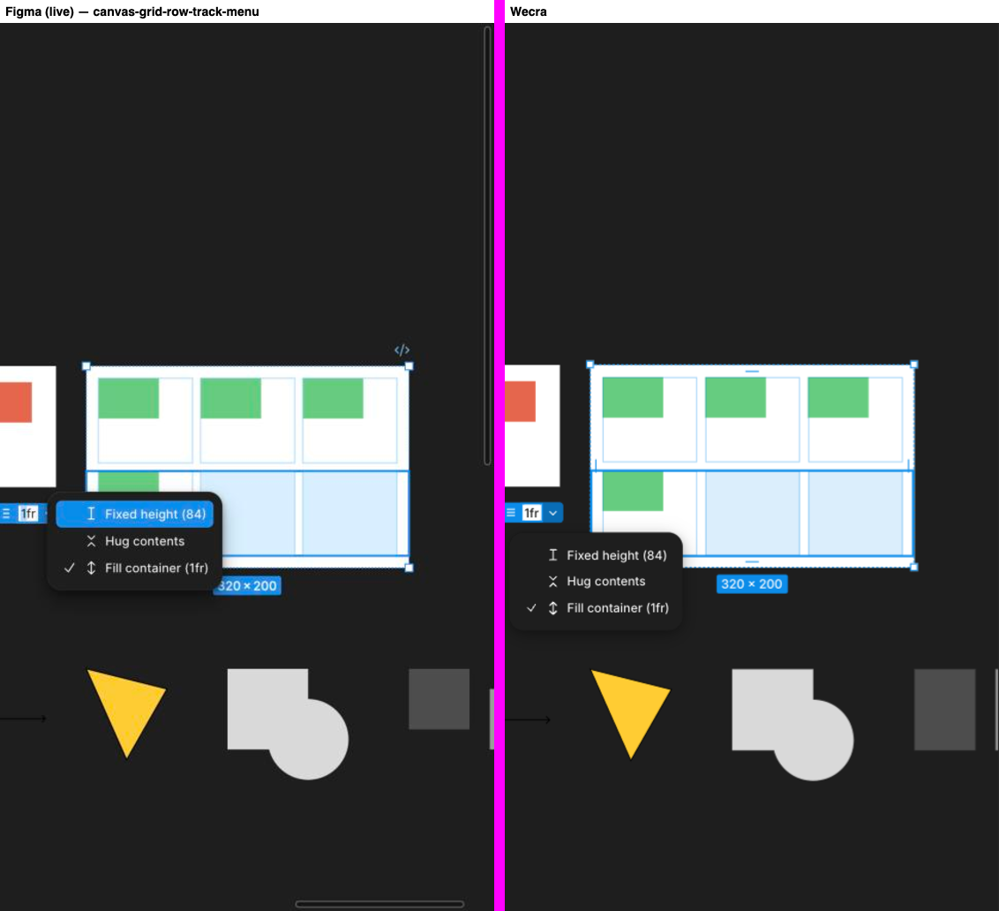
State: row 2 selected, chevron clicked: "1fr" turns into a field and the sizing list opens.
1. **[Minor] The list opens in a different place in a narrow pane.**
   * Live opens the list to the right of the chevron, with "Fixed height (84)" level with the pill.
   * Wecra opens it below-left of the pill (≈ 45 px left, 25 px lower).
   * At 1440 × 900 both sit at exactly @419,549 156 × 72 (`measure/popup-row-track-menu.diff`).
2. **[Minor] First option not highlighted.** Live highlights the first option ("Fixed height (84)") in the menu blue
   when the list opens. Wecra highlights none.
3. The padding bars, tick marks and missing `</>` are the same as above (not counted again).

### canvas-group-selected
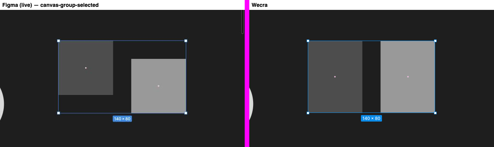
State: Group selected; its children are placed differently in the fixture. No chrome difference beyond G1.

### canvas-instance-selected
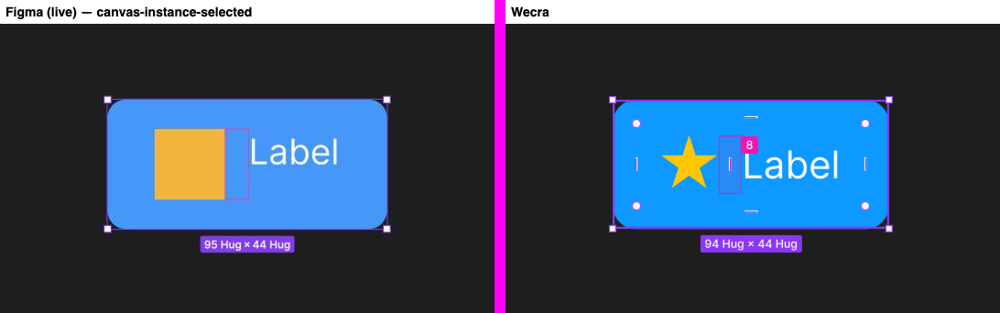
State: Button instance selected, pointer on its icon–label gap.
1. **[Major] The Hug width is 1 px narrower.** The label reads **"94 Hug × 44 Hug"**, live "95 Hug × 44 Hug". The text
   "Label" measures 1 px narrower, so the hugged button is 94 wide.
2. **[Minor] Hovered gap.**
   * Live outlines it with a plain pink box.
   * Wecra adds a pink hatch, a centre bar and an **"8" badge**.
   * Wecra also draws the button's white padding bars on all four sides.
3. G3 applies.

### canvas-main-component-selected
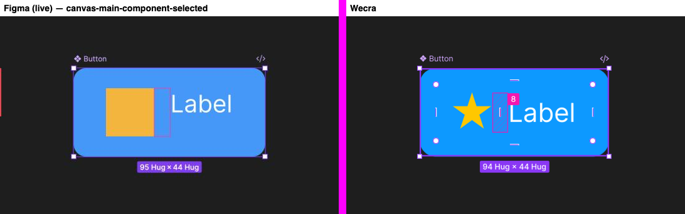
State: Button main component selected, pointer on the gap.
* The same as canvas-instance-selected #1 and #2 (not counted again), plus G3.
* "❖ Button" and the purple `</>` match.

### canvas-multi-select-two-shapes
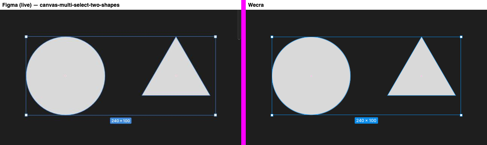
State: Ellipse + Polygon. No difference beyond G1.

### canvas-polygon-selected-handles
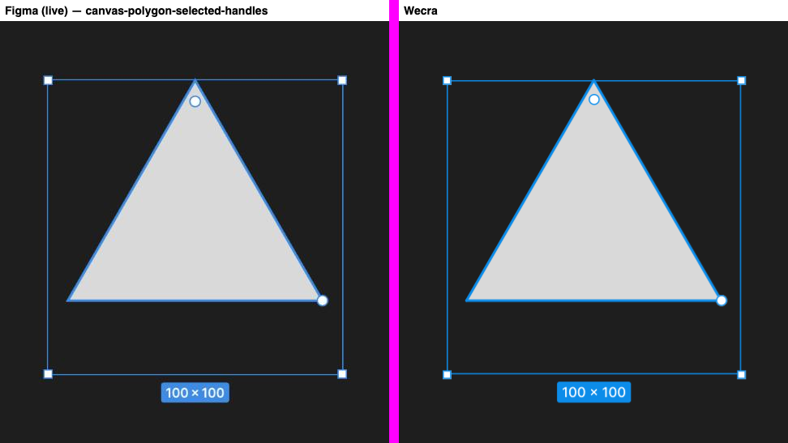
State: Polygon selected and hovered: radius and count rings. No difference beyond G1.

### canvas-rect-selected-hover-radius-handles
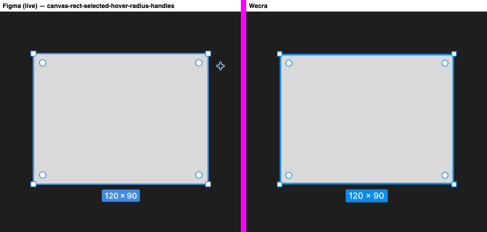
State: Rect selected and hovered. The four rings (inset, size) match. G2 applies.

### canvas-rect-selected
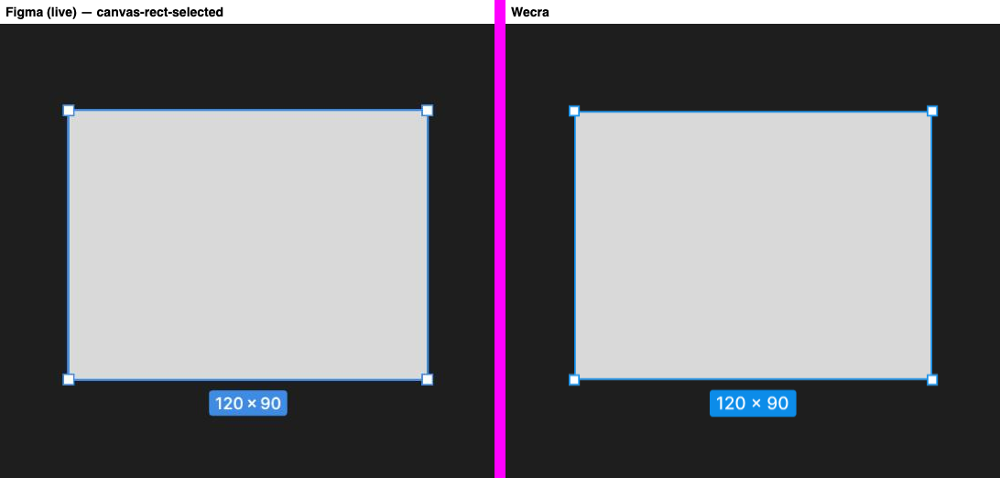
State: Rect selected, pointer away. No difference beyond G1.

### canvas-rotated-star-selected
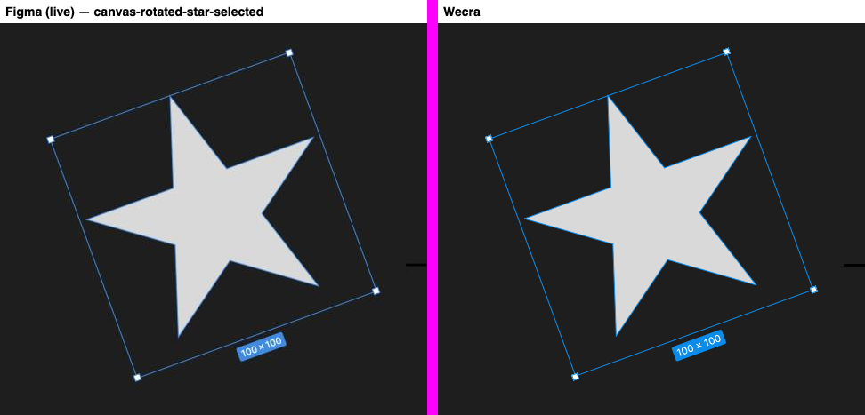
State: Star turned 20°. The box, handles and pill turn with it in both. No difference beyond G1.

### canvas-section-selected
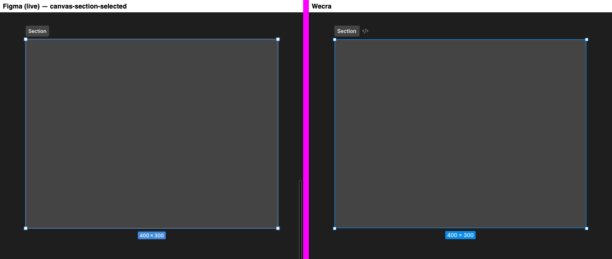
State: Section selected.
1. **[Minor] Extra </>.** Wecra draws a `</>` (dev status) right of the "Section" pill. Live draws none on a selected
   section.
2. **[Cosmetic] Wider pill.** The Section pill is ≈ 53 px wide against live's 49.

### canvas-star-selected-handles
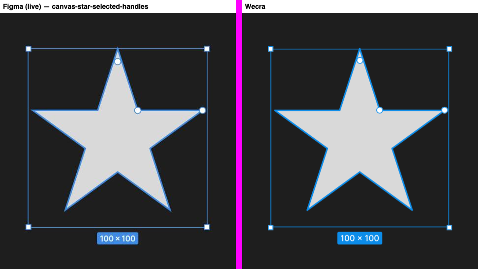
State: Star selected and hovered: radius, ratio and count rings. No difference beyond G1.

### canvas-text-selected
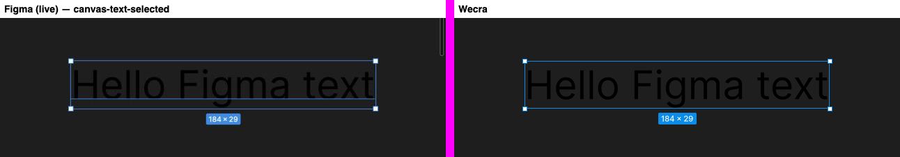
State: Text ("Hello Figma text", Inter 24) selected.
1. **[Minor] Missing baseline (possibly a state mismatch).** Live draws the baseline line inside the selected text's
   box, the hover underline. Wecra (pointer away) does not. The plain hover case below matches.

### canvas-text-edit-mode
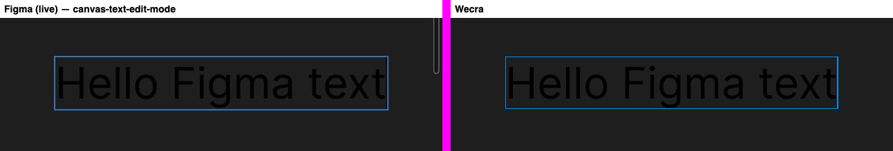
State: Enter on the text, caret at the end. The 1 px blue box and no handles match. No difference.

### canvas-text-edit-partial-selection
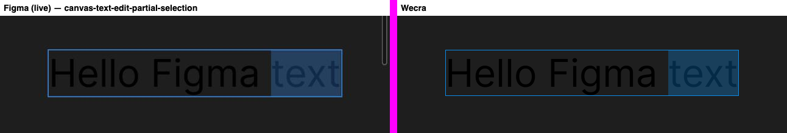
State: double-click on "text" selects the word. The translucent blue highlight matches. No difference.

### canvas-text-hover-baseline-underline
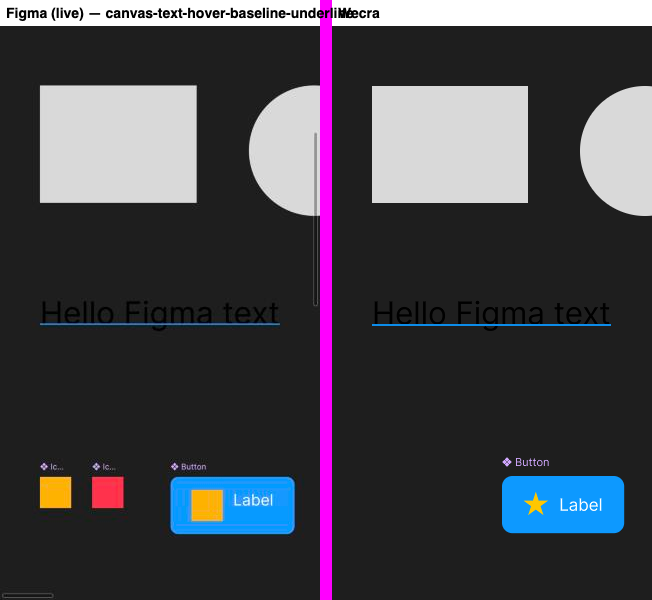
State: nothing selected, the text hovered: a blue underline at the baseline in both. No difference.

## img/ — full UI and panels

### grid-frame-selected-full-ui
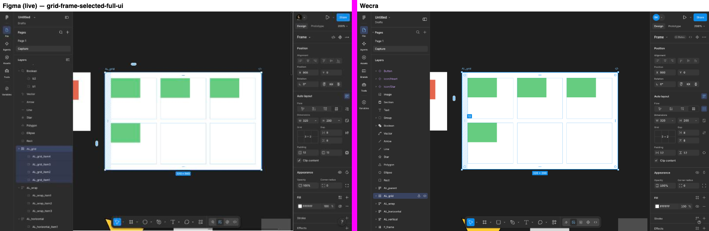
State: 1440 × 900 at 200 %, AL_grid selected, pointer in the left padding. The panel's numbers are in
`measure/panel-autolayout-grid.diff`.
1. **[Minor] Extra "12" badge (may depend on the pointer).** Wecra shows a "12" badge in the hovered left padding.
   Live hatches the padding but shows no badge.
2. **[Minor] Layers don't follow the selection.** Live's Layers list opens AL_grid to show its four children and
   scrolls to it. Wecra leaves AL_grid collapsed and the list unscrolled.
3. **Design panel: no difference.**
   * Every field (W 320 / H 200, grid 3 × 2, gaps 8 / 8, padding 12 / 12, Clip content) sits at live's x/y within
     ±1 px.
   * The real extras are O4 and O5.
4. G3 applies.

### grid-selected-hover-gap-1440
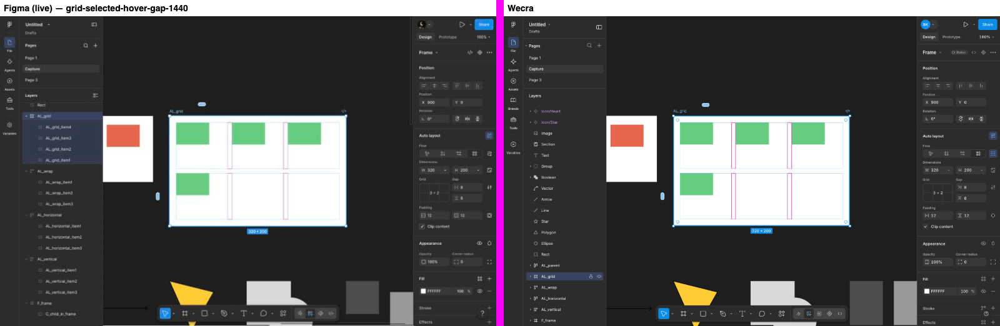
State: 160 %, AL_grid selected, pointer in a column gap. The pink boxes in every column gap of both rows match. The
Layers row is the same as above. G3 applies.

### grid-track-selected-grid-panel-and-menu-1440
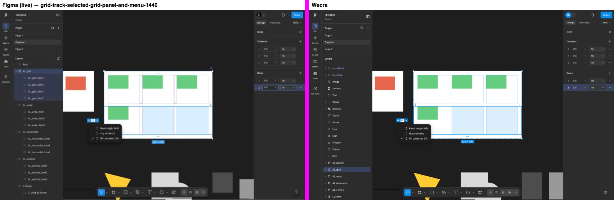
State: row 2 selected, its sizing list open. The Grid panel (Columns 1–3, Rows 1–2, row 2 highlighted) and the list's
place (@419,549) match.
1. **[Cosmetic] Gap boxes.** Live still shows the column-gap pink boxes from the previous hover. Wecra clears them.
2. The list's first item not being highlighted is the same as above (not counted again).

### left-find-results-and-filter-menu
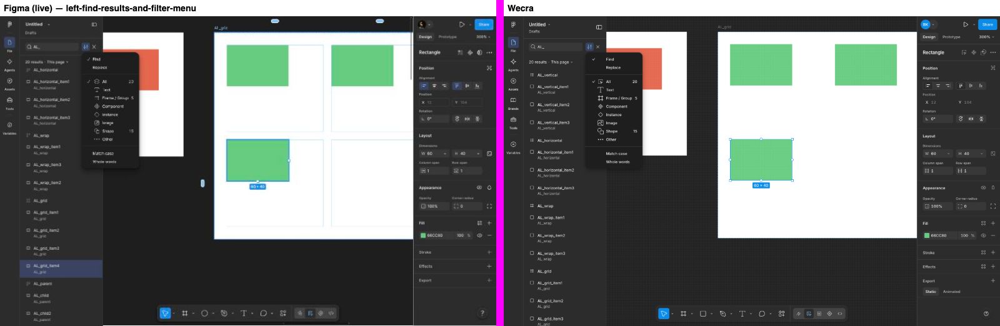
State: 300 %, AL_grid_item4 selected, Find "AL_" with its Settings (filter) menu open.
1. **[Minor] Wrong icon for auto-layout frames.** Find's results show the **frame "#" glyph** for AL_vertical,
   AL_horizontal and the other auto-layout frames. Live shows the auto-layout glyph (`img [Auto layout]` 16 × 16 at
   17, 9 in `left/find-filter-menu.txt`).
2. **[Minor] Extra arrows.** Wecra adds "↑ ↓" (Previous / Next result) on the results header. Live's header is only
   "20 results · This page ⌄".
3. **[Cosmetic] Focus ring.** Wecra's Find field keeps a blue focus ring while the menu is open. Live's field is
   unfocused and the filter button is shown pressed.
4. **[Minor] Grid cells hidden.** On canvas, live outlines the grid frame's cells while a **grid child** is selected.
   Wecra does not.
5. The filter menu matches: live @237,105 167 × 338, Wecra @237,105 166 × 338.

### left-rail-assets-components
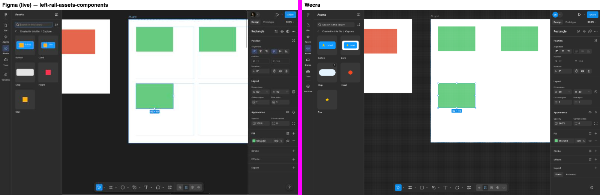
State: Assets › Created in this file › Capture.
1. **[Minor] Variant-count badge.** Wecra's **Chip** tile carries a "3" badge (the variant count). Live's tile has none.
2. **[Cosmetic] Search not focused.** Live's "Search in this library" field is focused (blue ring). Wecra's is not.

### left-rail-tools
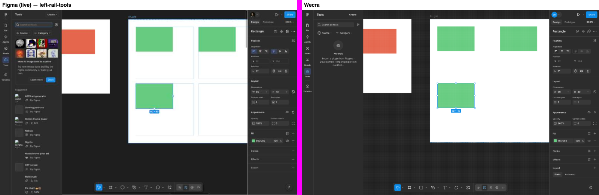
State: the Tools tab.
1. **[Major] Empty Tools tab.** Wecra shows "No tools — Import a plugin from Plugins › Development…". Live shows:
   * the Weave promo grid of AI image tools
   * the "More AI image tools to explore" card with Learn more / Got it
   * a **Suggested** list of community plugins
2. **[Minor] Wrong button by the search.** Live has a "?" help button right of the search. Wecra has a filter button
   there.

### left-rail-variables-full-view
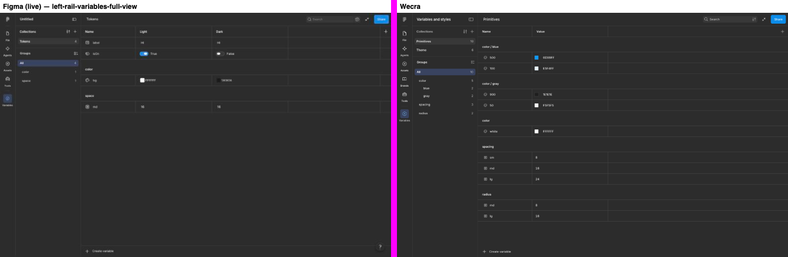
State: the full-window variables view, with a different fixture (`&doc=variables`), so there is no diff image.
1. **[Minor] Wrong panel title.** The view's top-left title reads **"Variables and styles"** in Wecra and the file name
   **"Untitled"** in live.
2. **[Cosmetic] Extra button in Search.** Wecra's Search box at the top right has an extra filter button.
3. **[Cosmetic] No help button.** Live shows the "?" help button at the bottom right; Wecra doesn't in this view.

### toolbar-actions-panel
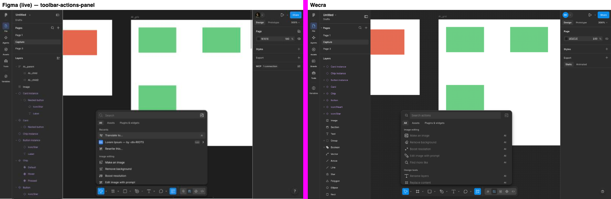
State: nothing selected, Actions open, no recents in Wecra (`measure/popup-actions-panel.diff`).
1. **[Major] AI rows look disabled.** The AI rows ("Make an image", "Remove background", "Rename layers"…) are drawn
   **dimmed** (`#ffffff66`), as if disabled. Live draws them in full white.
2. **[Minor] Search field.**
   * Placeholder: Wecra **"Search actions"**, live **"Search"**.
   * Wecra's magnifier sits outside a separate inner field box. Live's single field (431 × 32, `#383838`) holds the
     icon.
3. **[Minor] Section titles too bright.** "Image editing" / "Design tools" are near white in Wecra and `#ffffffb2` in
   live.
4. **[Cosmetic] Row icons differ.** Live uses Figma's AI-action icons; Wecra's are generic.
5. Size: 529 × 282 at y 550 against live's 529 × 354 at y 478. Live had three Recents (state). The x is O6.

### toolbar-shape-tools-menu
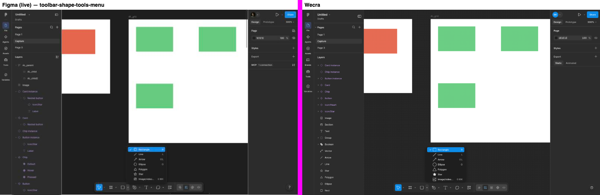
State: nothing selected, Shape tools open. The size (196 × 168), rows and keys match; the x is 596 against 611 (O6).
1. **[Cosmetic] Filled Star icon.** The "Star" row icon is filled in Wecra and an outline in live.

### vector-edit-mode-full-ui
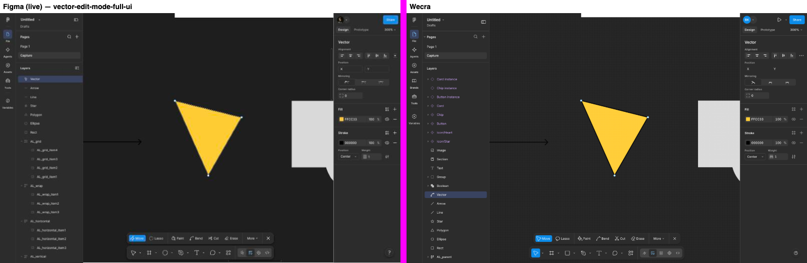
State: the Vector double-clicked, 300 %.
1. **[Minor] Stroke drawn instead of the edit path.** In vector edit live draws the path as a thin dotted light line
   over the shape. Wecra keeps drawing its solid black 1 px stroke.
2. The vector toolbar (Move, Lasso, Paint, Bend, Cut, Erase, More, ✕) and the panel sections match
   (`measure/panel-vector-edit-mode.diff`).

### panel-grid-dimensions-picker
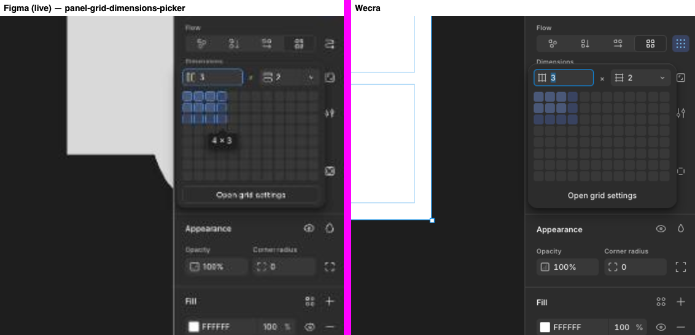
State: AL_grid, the grid picker open, pointer on cell 4 × 3. The place and size match (@1204,427 210 × 204).
1. **[Minor] No size tooltip.** Live shows a **"4 × 3" tooltip** under the hovered cells. Wecra shows none.
2. **[Minor] Hovered cells.** Live outlines the hovered cells (blue borders over `#4a5878`). Wecra fills them only.
3. **[Cosmetic] Borderless button.** Live's "Open grid settings" is a bordered button. Wecra's is borderless text.

### menu-main-view
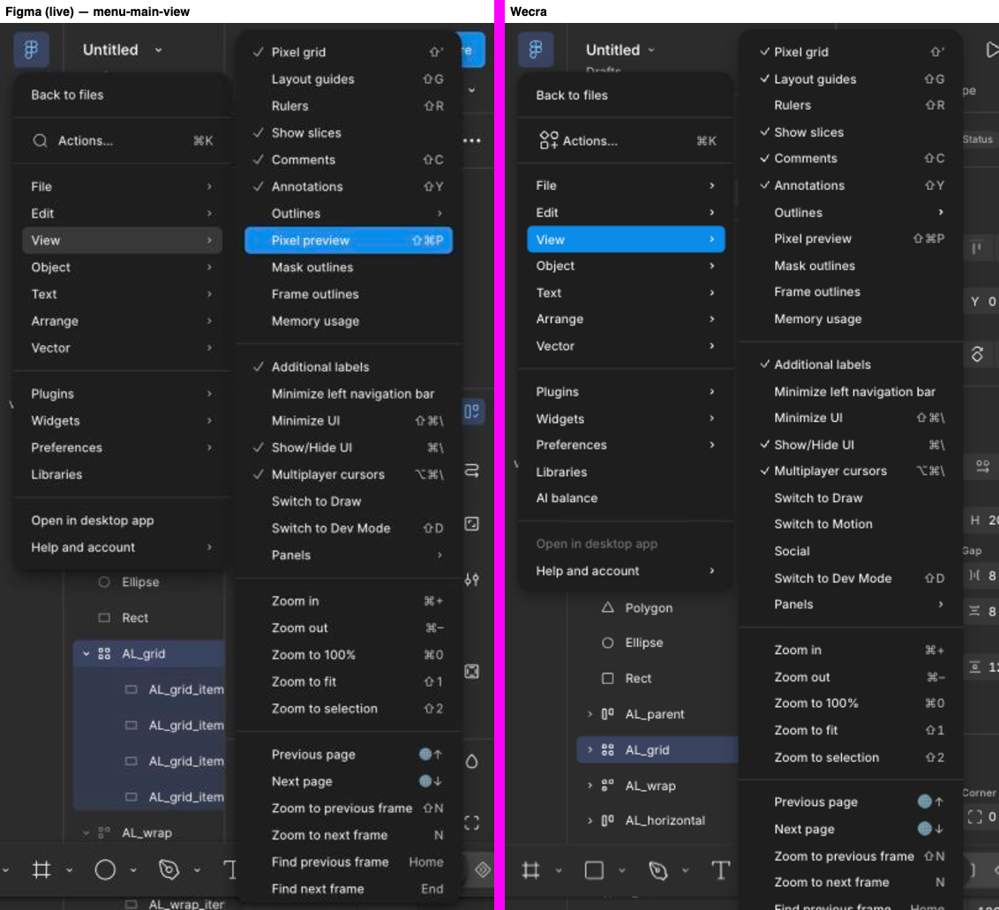
State: 444 × 798 pane at 0.9, the Figma menu › View.
1. **[Minor] Desktop-app row disabled.** "Open in desktop app" is disabled in Wecra (web build). It is enabled in live.
2. **[Cosmetic] Actions icon.** Wecra's "Actions…" icon is a grid-plus. Live's is a magnifier.
3. **[Minor] Additional labels not checked.** View › **Additional labels** shows no check in Wecra although both label
   settings were on (`propertyLabels`, `railLabels`). Live shows it checked.
4. O2 and O3 apply.

### panel-grid-autolayout-highres
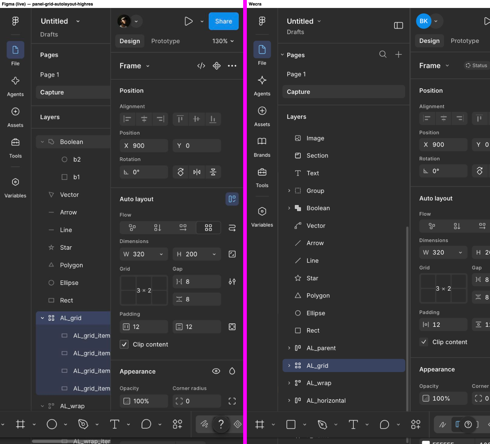
State: a narrow window (444 × 798 CSS at 1.8×), AL_grid selected.
1. **[Major] The narrow-window layout differs.**
   * In live the right panel stays fully visible and **overlaps the left panel**, which is cut at ≈ 201 px.
   * In Wecra the left panel keeps its full width and the **right panel is pushed off the window** (about 60 % of it
     shows).
2. **[Minor] Pages chevron.** Wecra's "Pages" header has a collapse chevron "⌄". Live's has none (also in
   `pages-divider-dashes`).
3. **[Cosmetic] Padding icon.** The horizontal padding icon differs: live a `▯|▯` box style, Wecra `|◘|`.
4. **[Cosmetic] Clip content checkbox.** Live draws a bordered box; Wecra draws a check without the box border.
5. O4 applies (the Status pill in the header).

### menu-context-main-component
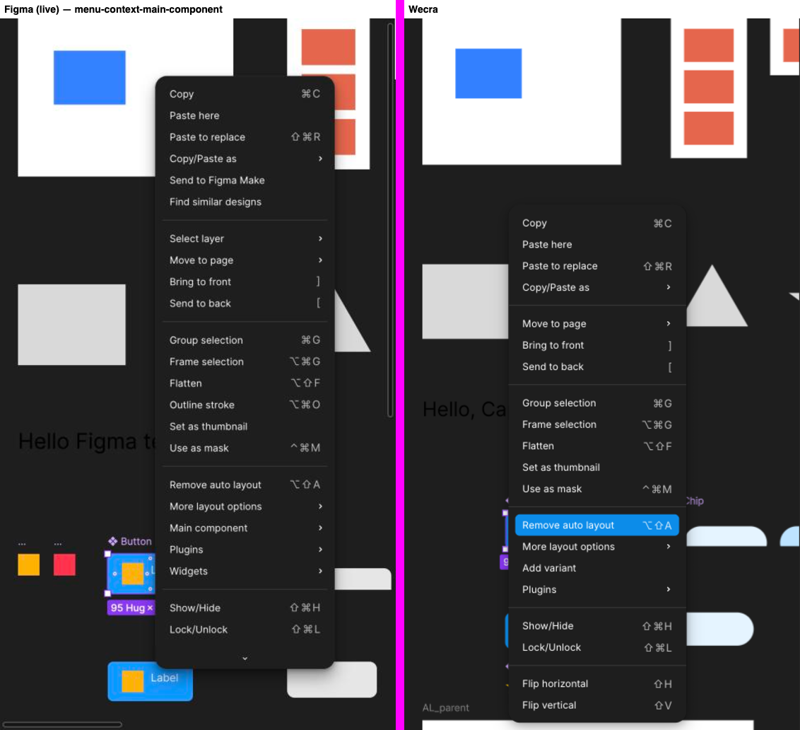
State: 1.08×, right-click on the Button main component's padding (`measure/popup-context-component.diff`).
1. **[Major] Rows missing.** The menu is 581 px tall against live's 677. It lacks:
   * **Send to Figma Make**
   * **Find similar designs**
   * **Outline stroke ⌥⌘O**
   * the **Main component ›** submenu
   * **Widgets ›**
2. **[Minor] Extra row.** Wecra has **Add variant** in the layout group. Live has no such row here.
3. **[Minor] Opens under the pointer.** Wecra opens the menu at the pointer, so the row under it lights up. Live
   placed its taller menu so that no row was under the pointer.

### menu-context-multi-and-smart-selection
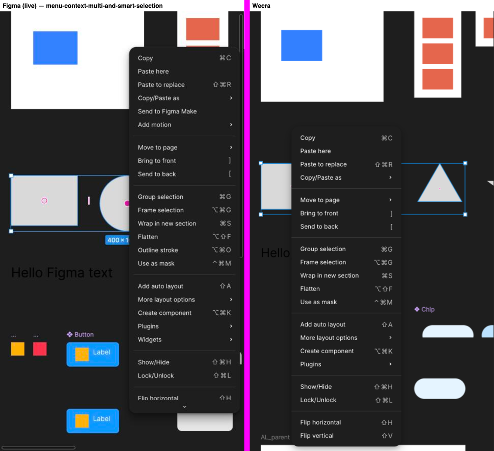
State: Rect + Ellipse + Polygon (evenly spaced), right-click (`measure/popup-context-multi.diff`).
1. **[Major] Rows missing.** The menu lacks **Send to Figma Make**, **Add motion ›**, **Outline stroke ⌥⌘O** and
   **Widgets ›** (581 against 677 px).
2. **[Minor] No smart-selection marks.** Live keeps the pink centre rings and the pink gap handle on the shapes while
   the menu is open. Wecra shows only small centre dots and no gap handle.

## behaviour/img

### autolayout-drag-01-pressed
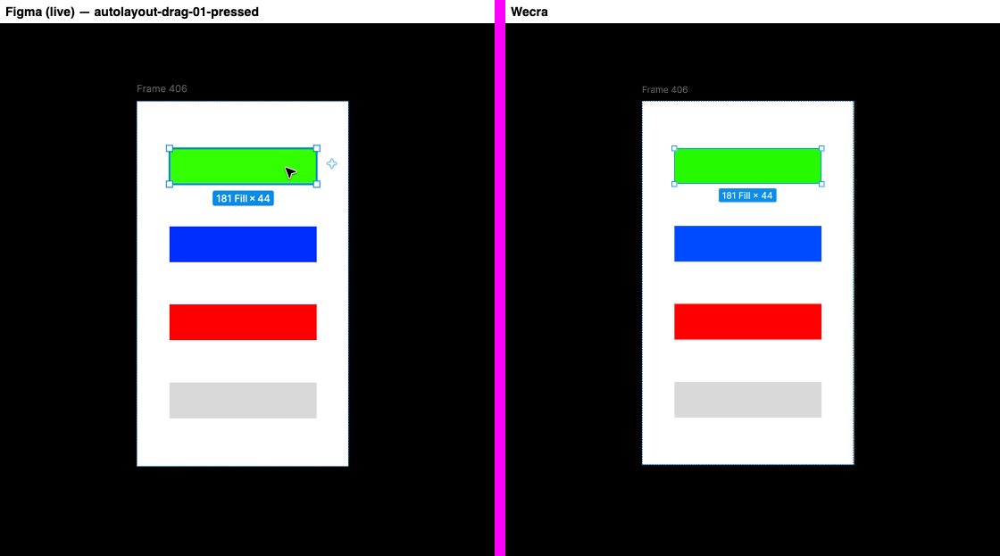
State: Frame 406 (vertical, padding 40 / 58, gap 52, four 181 × 44 Fill), green pressed.
1. **[Cosmetic] Thinner outline.** The pressed layer's outline is 2 px in live and 1 px in Wecra.
2. G2 applies.

### autolayout-drag-02-moving-chrome-kept
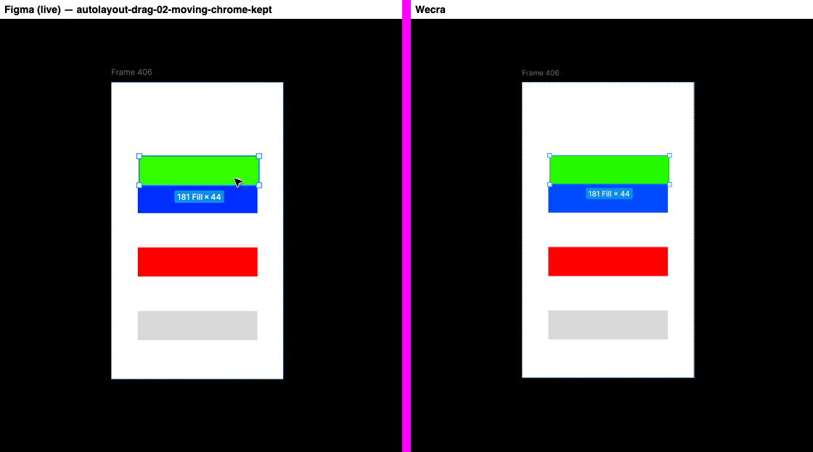
State: green moved 53 px down, short of blue's centre. The chrome is kept and the siblings are still. No difference.

### autolayout-drag-03-first-swap-chrome-hidden
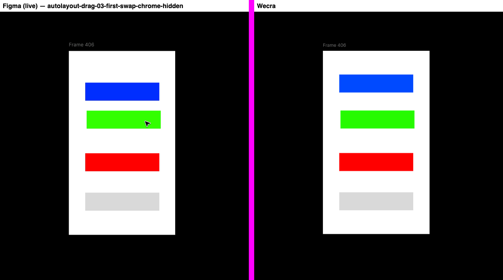
State: green past blue's centre; the chrome is hidden in both. Live catches blue mid-slide; Wecra's blue was already at
rest (timing, not counted).

### autolayout-drag-04-sibling-sliding
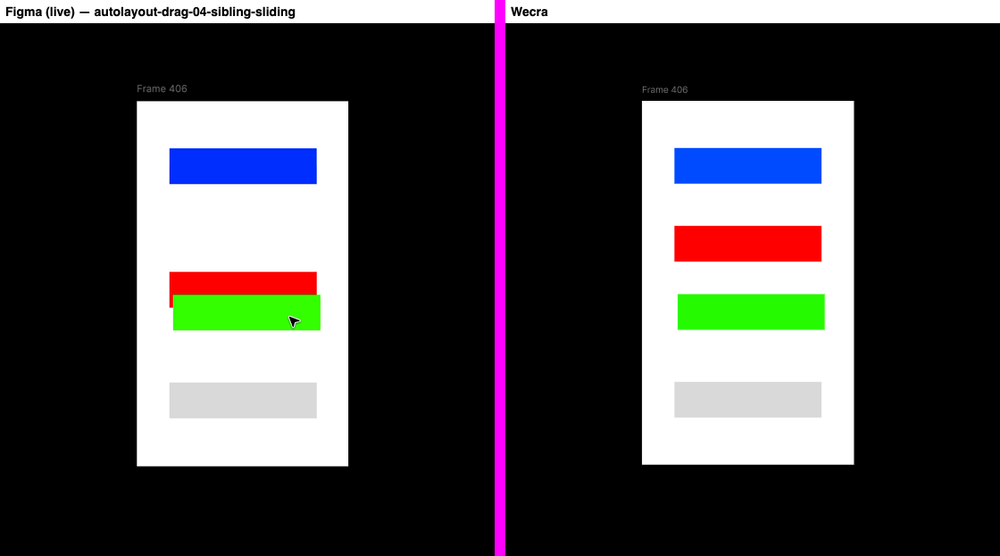
State: green past red's centre. Live has red mid-slide under green; Wecra's red had already arrived (timing, not
counted).

### autolayout-drag-05-drop-instant
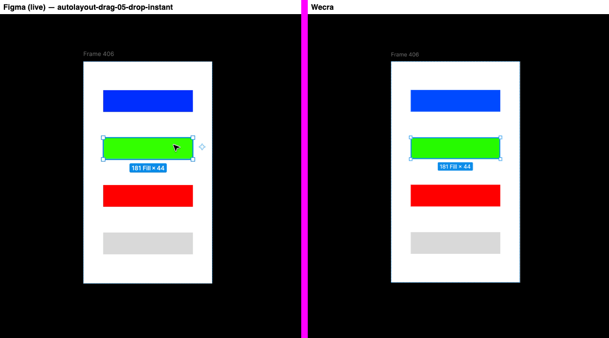
State: dropped in slot 2 and selected at once. No difference beyond G2.

### autolayout-drag-06-last-child-chrome-hidden-at-once

State: the frame turned 90° (flow left → right on screen), gap 10, ≈ 134 %; the last child moved a few px. The chrome
is hidden at once in both.
1. **[Major] The turned frame's title runs along its edge.**
   * Wecra draws the title **"Frame 406" turned 90° along the frame's left edge** (vertical text).
   * Live keeps it **horizontal above the top-left corner** of the on-screen box.
   * Round 15's rule ("a turned frame's name … along its edges") does not match live for a ±90° frame.

### autolayout-drag-07-rotated-sibling-sliding

State: blue dragged right past grey's centre. Grey is mid-slide in live and at rest in Wecra (timing). The title is
the same as 06 #1.

### autolayout-drag-08-rotated-drop

State: blue dropped at the end and selected, pointer over the frame.
1. **[Major] The child's size label is turned.**
   * Wecra draws **"181 Fill × 44" turned 90°** along the child's right edge.
   * Live keeps it **horizontal under the child**, centred on its on-screen bottom edge.
2. **[Minor] No parent hover outline.** Live outlines the hovered parent frame (2 px blue, blue title) while the child
   stays selected. Wecra shows only the dashed parent box.
3. G5 and G2 apply.

### autolayout-drag-09-overlap-before-centre-no-swap

State: blue (first) moved over half of green, short of its centre. There is no swap and the chrome is kept in both.
The turned size label is the same as 08 #1.

### autolayout-drag-r2-01-alt-copy-ghost-line

State: light theme, Frame 4883 (two 54 × 27, ≈ 370 %), ⌥-drag of the first child between the two. The 30 % ghost, the
2 px blue insertion line and the 2 px frame outline match.
1. **[Cosmetic] Ghost offset.** The ghost sits ≈ 50 px right of live's position. It follows the grab offset
   differently.
2. G6 applies (pixel grid at 370 %).

### autolayout-drag-r2-02-alt-copy-outside-opaque

State: the ⌥-copy dragged out to the left, onto the page; opaque in both.
1. **[Major] No smart guides.** Live draws red **smart guides with distance pills ("24", "2")** and outlines the
   aligned layer in red. Wecra draws **no guides, no pills and no red outline**.

### autolayout-drag-r2-03-drag-in-ghost-no-space

State: a page layer dragged into the frame, between children 1 and 2. The insertion line matches.
1. **[Minor] Ghost hard to see.** The ghost is hard to see in Wecra (only a faint band under the line). Live's is a
   clear light box around the pointer.

### autolayout-drag-r2-04-out-clipped-chrome-kept

State: the first child (red) dragged left, the pointer just outside the frame.
1. **[Major] Leaves the frame too early.** In live the layer is **still in the frame**:
   * It is clipped by it: only its inside part is red, and the rest shows as a blue outline.
   * Its chrome (handles, "54 Fill × 27") is kept.
   * The siblings keep their places.

   In Wecra it has **already left the frame**:
   * It is drawn whole and unclipped, with no chrome.
   * The siblings have closed up.

### autolayout-drag-r2-05-out-closed-at-once

State: red dragged well out. The frame closed up at once in both. No difference.

### autolayout-drag-r2-06-drag-in-red-ghost

State: red dragged back in from the page. The 30 % red ghost, the line, the frame outline and the siblings' light
outlines match. No difference.

### autolayout-drag-r2-07-dropped-fixed-width

State: red dropped in the middle and selected ("54 × 27"). It matches apart from G5 and G2.

### bulk-rename-dialog-and-smart-selection

State: Behaviour page (S1–S3 60 × 60, gap 20, 200 %), ⌘R. The dialog's size and content match:
* "Rename 3 layers"
* Preview S3 / S2 / S1
* Current name / Number ↑ / Number ↓
* Start ascending from 1
* Learn more, Cancel, Rename

1. **[Minor] Wrong field focused.** Live focuses **"Rename to"**. Wecra focuses **"Match (optional)"**.
2. **[Cosmetic] Dialog sits lower.** The dialog is ≈ 14 px lower in Wecra.

### minimize-ui-nothing-selected

State: Minimize UI (⇧⌘\), nothing selected, 250 %.
1. **[Minor] The top-right pill's order differs.**
   * Live: avatar ▾ · **250 % ▾** · ▶ ▾ · Share.
   * Wecra: avatar ▾ · ▶ ▾ · Share · **250 % ▾** (zoom last).

### minimize-ui-with-selection-floating-panel

State: minimized, S2 selected: the floating Design panel. Its size, header and sections match. G2 and O5 apply.

### outlines-shift-cmd-o

State: ⇧⌘O on the (rebuilt) Behaviour page, so there is no diff image.
1. **[Minor] No Cancel in the toast.** Live's toast reads **"Outlines visible | Cancel"**, with an action button.
   Wecra's reads "Outlines visible" with no Cancel.
2. The outline drawing (1 px light outlines, grey text) matches.

### smart-selection-three-equal-rects

State: S1–S3 selected, 200 %.
1. **[Cosmetic] Centre dots are pink.** Wecra's centre dots are pinkish. Live's are light grey before hover.

### smart-selection-after-dragging-spacing-handle

State: one gap handle dragged +22. Every gap becomes 42 in both (`[500, 602, 704]`), "264 × 60". The rings, gap bars
and "42" badge match. No difference.

### pixel-grid-200-none

State: 200 %. No grid in either. No difference.

### pixel-grid-300

State: 300 %. See G6.

### pixel-grid-800

State: 800 %. See G6.

### pages-divider-dashes

State: pages Page 1, Capture, Page 3, Behaviour, "---", "– Divider test".
1. **[Minor] Divider row too short.** Live gives the divider a full row (≈ 32 px, the line in the middle). Wecra's row
   is ≈ 16 px, so "– Divider test" sits ≈ 16 px higher.
2. **[Cosmetic] Divider line too strong.** Live's line is fainter and looks dashed. Wecra's is a solid, lighter line.

### layers-drag-across-eyes-hidden-rows

State: S3, S2 and S1 hidden, the S1 row hovered.
1. **[Cosmetic] Eye button background.** The hovered row's eye button has a square hover background in live. Wecra
   draws the glyph alone.

### layers-row-inline-rename

State: inline rename of S1 with its text selected. No difference: the field's start, blue border and selected text
match.

### move-big-layer-nested-into-small-frame

State (approximate): a 333 × 133 layer dropped by the cursor onto SmallFrame (100 × 100). It nests (its parent becomes
`20:20`) and is clipped in both. Only G2 and G3 apply. Live's neighbours come from a fixture we don't have.

## Captures that could not be recreated exactly

None failed, but these are approximate:

* **`autolayout-drag-03`, `-04`, `-07`:** the mid-slide moments. Headless capture timing caught the sibling at rest, so
  only the end states are compared.
* **`outlines-shift-cmd-o`, `bulk-rename-…`, `minimize-ui-*`, `layers-*`, `pages-divider-dashes`, `pixel-grid-*`,
  `move-big-layer-…`:** live's **Behaviour** page isn't in Wecra's demo, so it was rebuilt from the behaviour notes and
  the captures. The layers' positions and colours are approximate.
* **`left-rail-variables-full-view`:** live's `Tokens` collection isn't in the demo, so `&doc=variables` stands in
  and only the chrome is compared.
* **`canvas-frame-layout-guide-columns-unselected`, `canvas-text-selected`:** live's pointer position is unknown (it
  seems to have been hovering), so the hover-dependent findings are flagged "possibly a state mismatch".
