# Comparison 2026-10-18 — group B: agents UX, agent settings, shortcuts panel, chrome & cursors

Detection only — no product code, styles or tests were changed. Wecra was run from `main` at 0426c32c
(`npm run web -- --mode demo --port 5211`, headless Chrome, SwiftShader WebGL2).

How the Wecra side was made:

- **Regression shots** come from the repo's own scripts against the same server, so they show exactly the states the
  earlier screenshots show: `EDITOR_URL=http://localhost:5211 EDITOR_ONLY=agents AGENTS_UX_DIR=<dir>` (177 checks
  ok), `EDITOR_ONLY=chrome15` (43 ok), `EDITOR_ONLY=shortcuts` (87 ok). No check failed.
- **Against live Figma, shortcuts panel**: a capture at Figma's scale — a 1512 × 982 window at deviceScaleFactor
  1.3228 (2000 px wide, as the owner's `live-*.webp`), dark, the default demo file, the panel opened with ⌃⇧?, each
  tab clicked, the bottom 296 CSS px cropped (= the 392 px strip of the live images). Same pixel scale, so the
  `-diff.png` overlays line up.
- **Against live Figma, chrome**: a 2× (Retina) capture to match `figma-rotated-labels.png` / `figma-eyedropper.png`:
  a 332 × 423 "Frame 406" turned 37° at zoom 47.75 % on a black rectangle, selected; the eyedropper (I) over #000000
  with that frame selected, 60 px left of the right panel so the card slides along it.
- Compare images: reference left/top, Wecra right/bottom, the same scale (small crops shown 2×, nearest neighbour);
  `-diff.png` marks in pink every pixel whose channels differ by more than 24 (only where both have the same size
  and framing). The changed-pixel share is given per pair.

Severity: **Major** = visible at a glance / wrong behaviour or content; **Minor** = visible when compared side by
side; **Cosmetic** = a few px or a shade. Findings on our own UI are marked **[ours]**.

## Summary

| | Major | Minor | Cosmetic |
|---|---|---|---|
| Part 1 — Figma vs Wecra (shortcuts panel, chrome) | 4 | 16 | 13 |
| Part 2 — regression of Figma-copied UI (shortcuts, chrome15) | 0 | 2 | 4 |
| Part 3 — ours, no Figma original (agents UX, agent settings) | 1 | 10 | 8 |
| **Total** | **5** | **28** | **25** |

Top 10:

1. **Major** — the shortcuts panel's type is ~11 % larger than live Figma's (tab labels, row labels, cap glyphs): "Essential" 57 vs 50.6 CSS px wide; tabs drift right up to +54 px (Arrange); Essential's descriptions wrap differently.
2. **Major** — key caps lack Figma's glyph variants: live shows a serif capital **I** and a slashed zero **0** (Inter's disambiguation forms) in caps and on the drawn keyboard; ours plain I and 0.
3. **Major** — Tools tab icons are not Figma's: Move (outline arrow), Pencil, Pick color (live: filled eyedropper), Slice (live: knife), View comments (live: bubble with a tail, ours: plain circle).
4. **Major [ours]** — Agent settings: "Antigravity (Google AI)" cuts its state to "Con…", so the row no longer says Connected.
5. **Minor** — a turned frame shows `</>` at its top-right corner in Wecra; live Figma shows none in the same state.
6. **Minor** — the selection blue on the canvas: live badge #3F8AE2, ours #0C8CE9 (could be the capture's colour profile — verify on a live Mac).
7. **Minor** — Layout tab: "Keyboard layout:" ~16 px wider so the select starts 16 px further right; "Learn more" 7 px right and ~9 px higher than live.
8. **Minor** — the layout select opens with "Generic" highlighted in blue; live shows only the ✓.
9. **Minor [ours]** — a finished step group no longer reads "Thinking · N steps" (docs/editor.md) but its last step ("Edited layers"); docs and code disagree.
10. **Minor (regression)** — text renders a little heavier / wider than on 2026-10-10 (shortcuts tabs, chat text, menus), moving it further from Figma's narrower type.

Couldn't be recreated: `live-components.webp` (no demo file has an enabled library, so there is no Components tab);
`owner-macbook-turkish-q.webp` (a photo of a physical keyboard — checked through `ours-layout-tr-dark` instead); the
macOS menu bar and desktop tab bar in `live-window-*.webp` (the web demo has no desktop shell); Figma's *used* state
(the owner's own history: the Cursor tab and many rows blue — ours renders lit rows, sampled, but starts unused); the
five `agents-ux/live-*` shots (the built Electron app with the owner's real Antigravity — set next to the demo's
stand-in agent instead); `settings-gemini.png` (the Gemini CLI page was removed on purpose in r13-agents-ux — compared
with the Antigravity page that replaced it).

---

# Part 1 — Figma vs Wecra

## 1.1 Keyboard shortcuts › Essential — `shortcuts-panel/live-essential.webp`

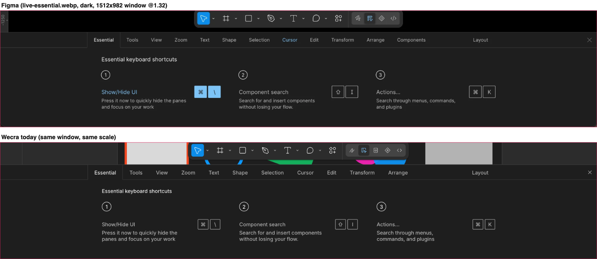

Diff: `images/shortcuts-live-essential-diff.png` (17.9 % changed). Recreated: dark, 1512 × 982 at 1.3228, panel on
Essential. Not recreated: the owner's usage (Show/Hide UI lit, Cursor tab blue).

1. **Major — typography.** Every label is drawn larger than live: "Essential" is 50.6 CSS px wide live, 57 ours
   (≈ 0.89×, consistent with ~11.5–12 px type against ours 13 px, weight 450, letter-spacing −0.03). The README's
   "13px labels" conflicts with this measurement — worth re-checking against live Figma's CSS.
2. **Major — tab positions.** The tabs start at the same x (Essential's label 237 live / 238 ours) but drift: Tools
   +6.5, View +12 … Arrange +54 CSS px. Layout and ✕ are anchored right and match within 3 px.
3. Minor — the descriptions wrap differently: live "Press it now to quickly hide the panes / and focus on your work",
   ours "…hide the / panes and focus on your work"; "Search through menus, commands, / and plugins" vs "…menus, /
   commands, and plugins".
4. Minor — cap glyphs are smaller live (≈ 11 px type in a 26 cap); the ⇧ **I** cap shows a serif I live, plain ours.
5. Cosmetic — the tab row's top line sits 1–2 CSS px lower in ours.
6. Cosmetic — the toolbar's mode switch shows 5 modes in ours (Draw, Design, Social [ours], Motion [ours], Dev) vs 4
   live — documented as ours; listed only because it shows in the strip.

## 1.2 Tools — `live-tools.webp`, `live-window-tools.webp`

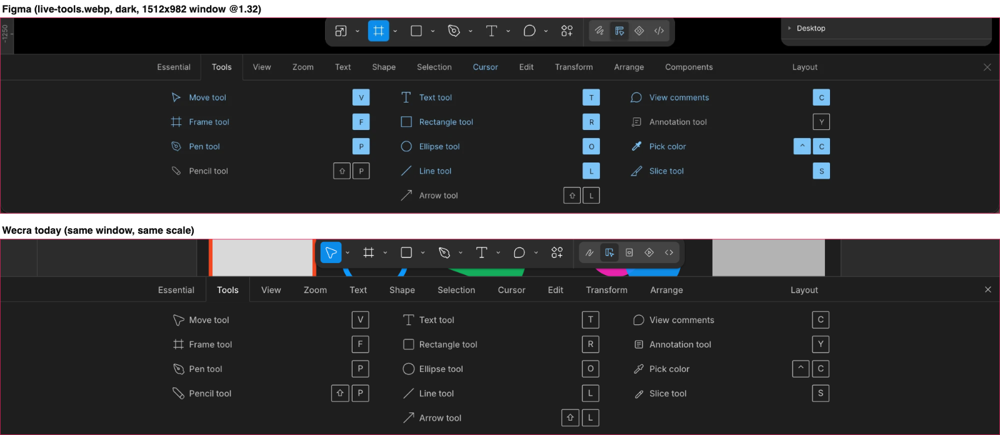

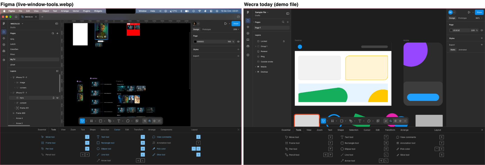

Diff: `images/shortcuts-live-tools-diff.png` (16.7 %). The full-window shot can't be matched in the shell: live has
the macOS menu bar (~30 CSS) and the desktop tab bar (~40 CSS) above the editor; the web demo starts at the editor.
The panel itself lines up: 240 high, the side panels end over it, the toolbar 12 over it, in both.

1. **Major — icons.** Move tool: live a solid-edged pointer, ours an outline arrow; Pencil: a different pencil glyph;
   Pick color: live a filled eyedropper, ours an outline one; Slice tool: live a knife, ours a small slanted blade;
   View comments: live a speech bubble with its tail, ours a plain circle; Annotation tool: close, ours a bit larger.
2. (Typography as 1.1 #1, not counted again: "Rectangle tool" ends 7 CSS px further right.)
3. Minor — two-cap rows (⇧ P, ⇧ L, ^ C) start up to 4 CSS px further left in ours: the caps' gap / padding is wider.
4. Cosmetic — row y positions match (37 apart, the first 26 under the tab row) within 1 px.

## 1.3 View — `live-view.webp`

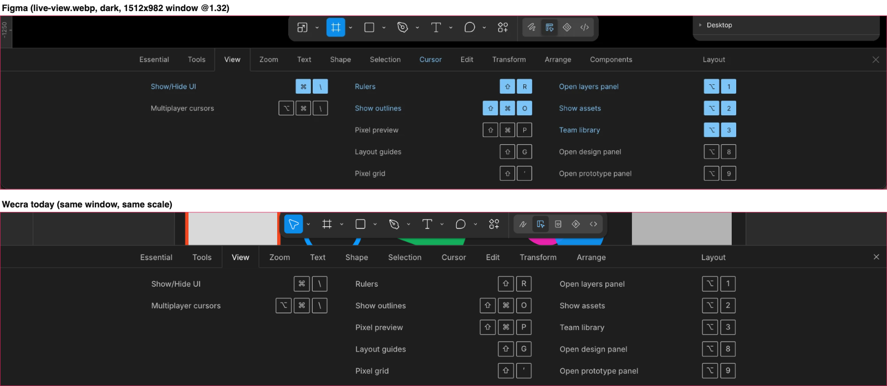

Diff: `images/shortcuts-live-view-diff.png` (17.5 %).

1. Minor — three-cap rows (⇧ ⌘ O, ⌥ ⌘ \\, ⇧ ⌘ P) start 4–6 CSS px further left in ours (wider caps and gaps).
2. Cosmetic — the "used" colour matches when lit: ours #7CC4F8 (cap fill and label), live #7DC4F7 (sampled: ours
   `403-shortcuts-used-dark` Rulers vs live Rulers).
3. (No difference) labels, keys, order and columns match live 1:1.

## 1.4 Zoom — `live-zoom.webp`

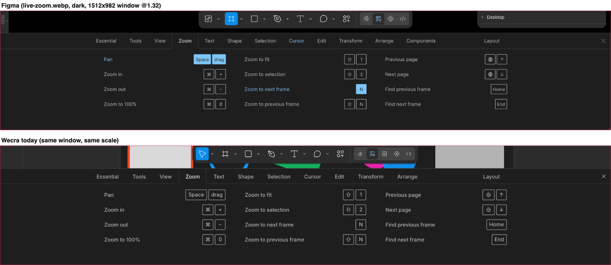

Diff: `images/shortcuts-live-zoom-diff.png` (16.2 %).

1. **Major — glyph variants.** Live "⌘ 0" (Zoom to 100%) shows a slashed zero; ours a plain 0 (also Transform, the
   Layout keyboard) — together with the serif I of 1.1 #4 / 1.5 #1.
2. Minor — word caps ("Space", "drag", "Home", "End") carry larger text in ours: "Space drag" 8 CSS px wider, starting
   further left.
3. Cosmetic — the 🌐 cap's globe is a thinner outline in ours.

## 1.5 Text — `live-text.webp`, `live-window-text.webp`

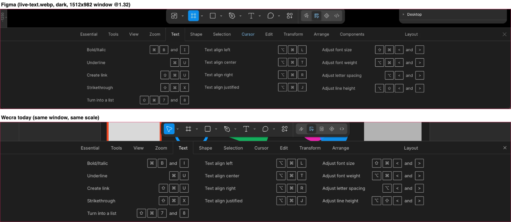

Diff: `images/shortcuts-live-text-diff.png` (17.3 %).

1. Minor — the I in "⌘ B and I" is a serif I live, plain ours.
2. Minor — "and" between caps: the same word, drawn larger in ours, so those rows' caps start 6–9 px further left.
3. Cosmetic — live rows holding an "and" are ~1 CSS px taller (38 vs 37), so by the 4th row of the right column live
   is 2 px lower than ours (also Arrange).

## 1.6 Shape — `live-shape.webp`

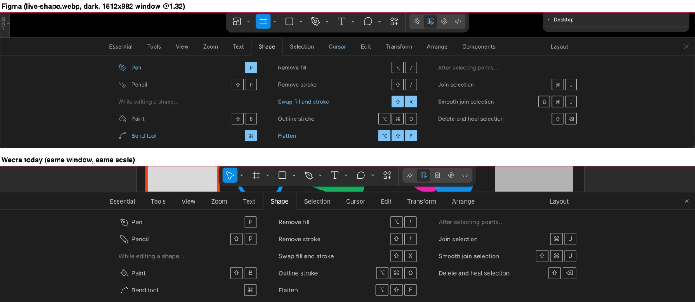

Diff: `images/shortcuts-live-shape-diff.png` (16.9 %).

1. Minor — icons: Pen (live a compact nib, ours a larger one), Bend tool (live a curve with a node, ours an arc with
   a hook), Pencil as 1.2.
2. Cosmetic — hints "While editing a shape…" / "After selecting points…": same tertiary role, larger type in ours.

## 1.7 Selection — `live-selection.webp`

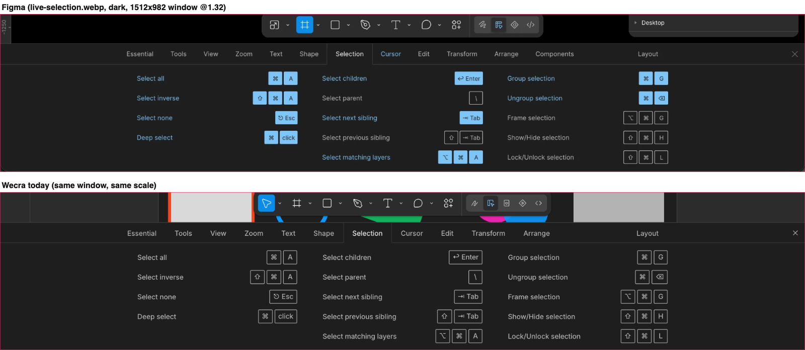

Diff: `images/shortcuts-live-selection-diff.png` (19.0 %).

1. Minor — word caps "↩ Enter", "⇥ Tab", "⎋ Esc", "click" are wider in ours (Enter: 66 vs 56 image px).
2. (No difference) content matches live.

## 1.8 Cursor — `live-cursor.webp`

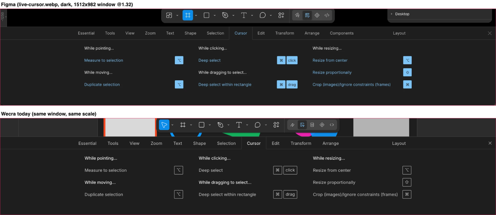

Diff: `images/shortcuts-live-cursor-diff.png` (16.8 %).

1. Cosmetic — the longest label "Crop (images)/Ignore constraints (frames)" ends 18 CSS px further right (typography);
   headings in the text colour, rows in secondary — the same roles as live.

## 1.9 Edit — `live-edit.webp`

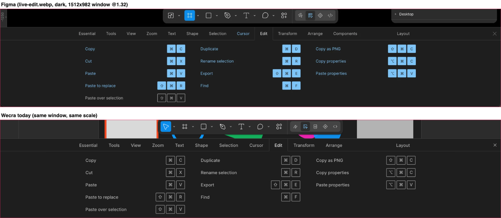

Diff: `images/shortcuts-live-edit-diff.png` (19.1 %). Content and positions match apart from 1.1's typography.

## 1.10 Transform — `live-transform.webp`

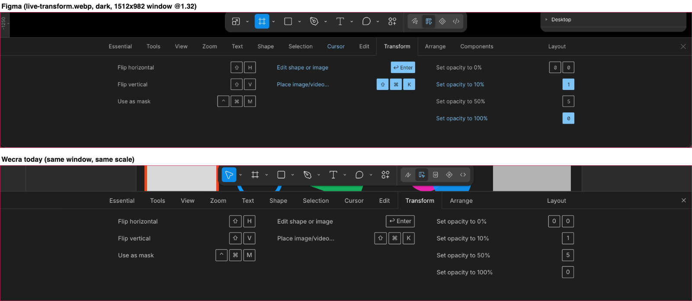

Diff: `images/shortcuts-live-transform-diff.png` (16.0 %).

1. Minor — "Set opacity to 0%": live "0̸ 0̸" (slashed), ours "0 0"; "Set opacity to 100%": live 0̸, ours 0.

## 1.11 Arrange — `live-arrange.webp`

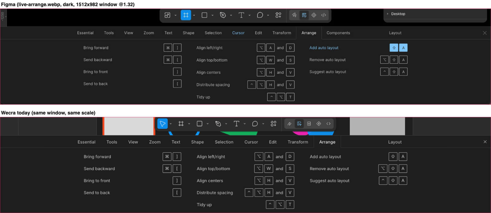

Diff: `images/shortcuts-live-arrange-diff.png` (16.6 %). Content matches; the "and" rows' extra pixel (1.5 #3) shows
here too (counted once).

## 1.12 Layout — `live-layout.webp`

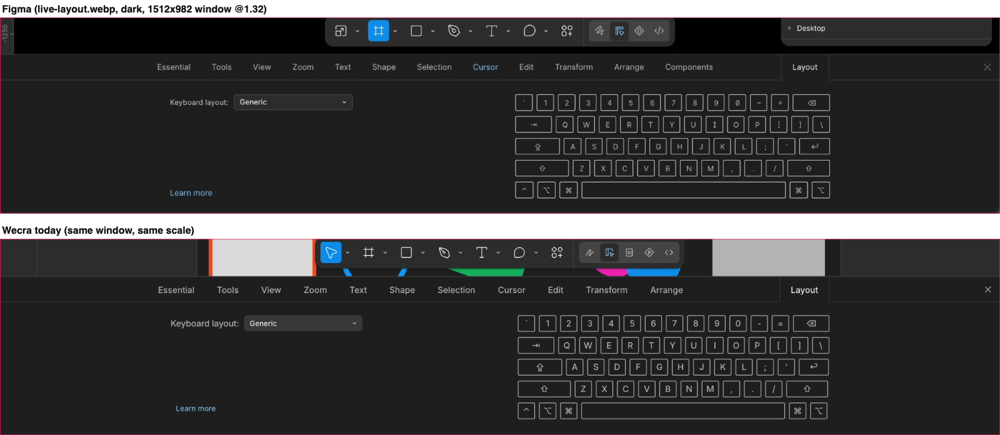

Diff: `images/shortcuts-live-layout-diff.png` (17.3 %).

1. Minor — "Keyboard layout:" is ~16 CSS px wider, so the select starts 16 px further right (its width the same,
   178 vs 179.5).
2. Minor — "Learn more" sits 7 CSS px further right (live starts it at the label's x) and ~9 px higher.
3. Cosmetic — the drawn keyboard's first row ~2 CSS px higher; key glyphs larger; I and 0 as 1.4.

## 1.13 Layout select open — `live-layout-select.webp`

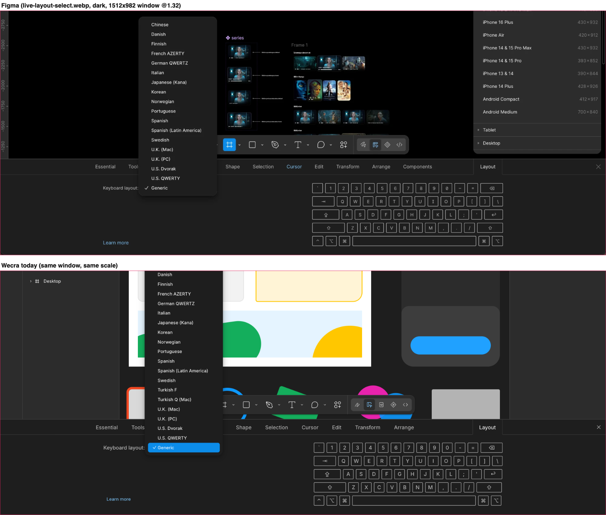

Recreated: the select clicked open (the canvas behind is another file).

1. Minor — ours highlights the checked "Generic" in the selection blue as the menu opens; live shows no highlighted
   row, only the ✓.
2. Cosmetic — the menu sits 16 CSS px further right (it follows the wider label, 1.12 #1); its width is the same (~195).
3. (By design) ours lists Turkish F and Turkish Q (Mac) between Swedish and U.K. (README).

## 1.14 Components tab — `live-components.webp` — not recreated

The tab only shows when the file has an enabled library (`ShortcutsPanel.tsx`, Atlas 03 §8); no demo file enables one
in the web build, so it can't be opened.

## 1.15 A turned frame's name and badge — `chrome-cursors/figma-rotated-labels.png`

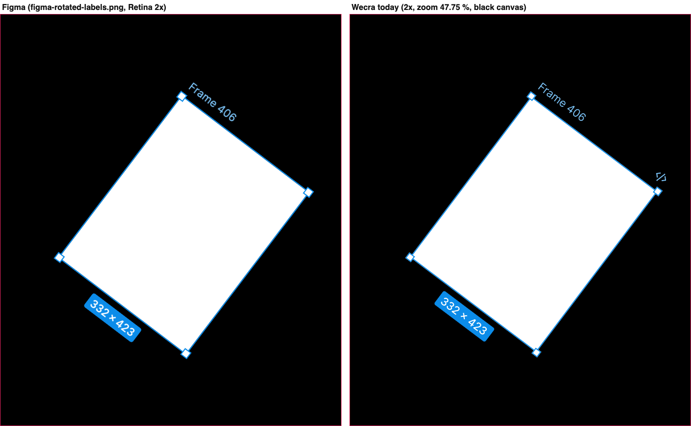

Diff: `images/chrome-figma-rotated-labels-diff.png` (2.2 %). Recreated at 2×: 332 × 423 turned 37°, zoom 47.75 %,
black canvas, selected. The corners land within 2–3 device px of live's — the overlay lines up.

1. Minor — ours draws the `</>` button at the top-right corner, turned; live shows none in this state.
2. Minor — the badge's blue: live #3F8AE2, ours #0C8CE9 (the outline and handles follow). Live's may be a
   colour-profile shift of the capture; check on screen.
3. Cosmetic — the W × H badge lies ~2 CSS px further right / up along the edge than live's.
4. Cosmetic — "Frame 406": same place and angle; ours a shade darker in an anti-aliased sample (#5484A7 vs #6188AA).

## 1.16 The eyedropper's card — `chrome-cursors/figma-eyedropper.png`

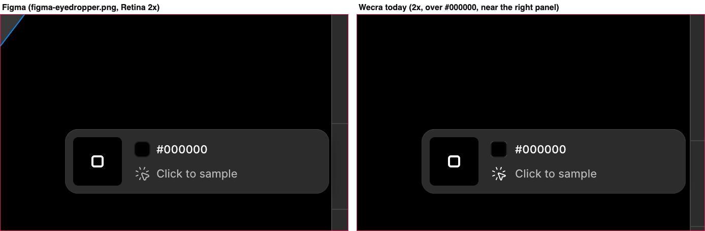

Diff: `images/chrome-figma-eyedropper-diff.png` (2.2 %). Recreated at 2×: I over #000000 with a layer selected, the
card against the right panel.

1. Minor — the hex and "Click to sample" start 2 CSS px further right (156 vs 154) and run ~3 px wider.
2. Cosmetic — the card stops 4 CSS px off the right panel; live 2.
3. (Same) 260 × 64 card, 48 × 48 preview 8 in, #2C2C2C, the swatch, the wording. (With nothing selected ours reads
   "Click to copy" — another state, not compared.)

---

# Part 2 — Regression of Figma-copied UI (our earlier screenshots vs today)

## 2.1 Shortcuts panel — `shortcuts-panel/ours-*.png` (12 shots, 2026-10-10)

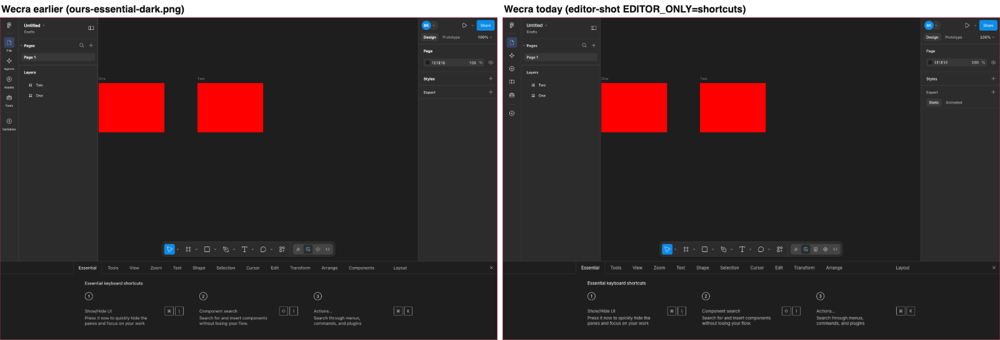

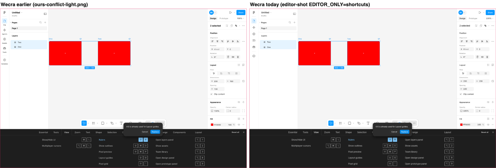

| reference | compare / diff | changed |
|---|---|---|
| ours-essential-dark | `images/shortcuts-ours-essential-dark-{compare,diff}.png` | 1.2 % |
| ours-essential-light | `images/shortcuts-ours-essential-light-{compare,diff}.png` | 1.3 % |
| ours-tools-dark | `images/shortcuts-ours-tools-dark-{compare,diff}.png` | 0.9 % |
| ours-text-dark | `images/shortcuts-ours-text-dark-{compare,diff}.png` | 1.2 % |
| ours-selection-dark | `images/shortcuts-ours-selection-dark-{compare,diff}.png` | 1.2 % |
| ours-arrange-dark | `images/shortcuts-ours-arrange-dark-{compare,diff}.png` | 1.1 % |
| ours-layout-dark | `images/shortcuts-ours-layout-dark-{compare,diff}.png` | 0.8 % |
| ours-used-dark | `images/shortcuts-ours-used-dark-{compare,diff}.png` | 1.0 % |
| ours-recording-dark | `images/shortcuts-ours-recording-dark-{compare,diff}.png` | 1.2 % |
| ours-conflict-light | `images/shortcuts-ours-conflict-light-{compare,diff}.png` | 1.2 % |
| ours-layout-de-dark | `images/shortcuts-ours-layout-de-dark-{compare,diff}.png` | 1.2 % |
| ours-layout-tr-dark | `images/shortcuts-ours-layout-tr-dark-{compare,diff}.png` | 0.4 % |

Recreated: editor-shot `EDITOR_ONLY=shortcuts`, the same states (1512 × 982, 1×).

1. Minor — text renders a little heavier and wider today in the tab row (the Transform label 682 → 686 px, each tab
   ~0.5 px wider) and in the descriptions — further from Figma's narrower type (1.1 #1).
2. Minor — the "Components" tab of the 10-10 shots is gone in this file without libraries. That matches Figma's rule
   (Atlas 03 §8), so a fix rather than a regression — listed so the shorter tab row isn't a surprise.
3. Cosmetic — the left rail is icon-only today (no File / Agents / Assets / Tools / Variables captions, and a book
   icon between Assets and Tools); the 10-10 shots had captions.
4. Cosmetic — the right panel's Export section now shows "Static / Animated" (Motion [ours]); the toolbar's mode
   switch has 5 modes (was 4).
5. (Same) the Turkish Q keyboard: 0.4 %, text only; the drawing still matches the README's key-by-key check against
   `owner-macbook-turkish-q.webp` (a photo — can't be recreated).

## 2.2 Chrome & cursors — `chrome-cursors/chrome15-*.png`, `ours-before-rotated-labels.png`

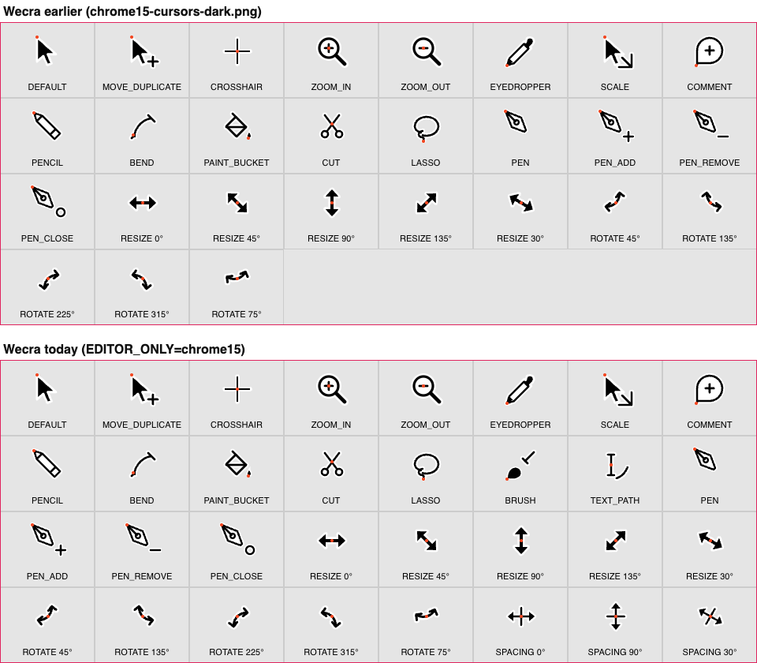

Diff: `images/chrome15-cursors-dark-diff.png` (4.6 %). Also `images/chrome15-rotated-labels-{dark,light}-compare.png`
(0.01 %), `images/chrome15-eyedropper-{dark,light}-compare.png` (0 %), `images/chrome-ours-before-rotated-labels-compare.png`.

1. Cosmetic — the cursor sheet gained BRUSH, TEXT_PATH and SPACING 0° / 90° / 30° since 10-10, so every later cell
   moved; editor-shot's 960 × 384 crop now ends at SPACING 30° and would cut off any further cursor (a shot-script
   limit, not a UI one).
2. Cosmetic — none of the cursors themselves changed shape (diff only where cells moved).
3. (Same) the turned labels and the eyedropper card are pixel-identical to round 15.
4. (Fixed) `ours-before-rotated-labels.png` (upright name and badge, before round 15) vs today: today's is the turned
   version live Figma has.

---

# Part 3 — Ours — no Figma original [ours]

The Agents panel, its chats, step groups, image card, canvas placeholder, composer and Agent settings are ours —
judged on consistency with Figma's UI3 language and against their own earlier shots. Closest Figma counterparts:
Figma AI's panel (the shimmering "Thinking…" row and the image placeholder follow it — docs/editor.md "Waiting, Figma
AI's way") and Figma's comments panel (the chat list's rows).

## 3.1 Agent settings — `agents-settings/settings-list.png`

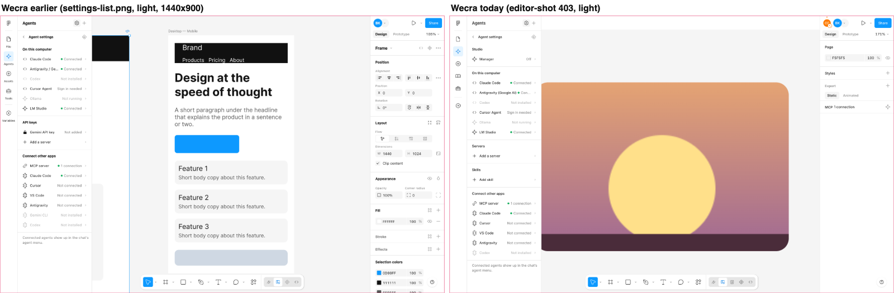

Recreated: editor-shot 403, light, 1440 × 900 (the canvas behind is another state of the run).

1. **Major [ours]** — "Antigravity (Google AI)" is too long for its row: the state is cut to "Con…" (the earlier
   "Antigravity / Ge…" cut the name and kept "Connected"). UI3 rows truncate the name, never the value.
2. Minor [ours] — new groups "Studio › Manager · Off" at the top and "Skills › Add skill"; "API keys" is now
   "Servers" (Gemini API key removed by design, r13-agents-ux); Gemini CLI gone from "Connect other apps".
3. Cosmetic [ours] — consistent with UI3: 32 px rows, 11 px text, 11 px semibold headings, not-installed rows dimmed,
   chevrons in icon-tertiary, a 1 px divider between groups.

## 3.2 The Antigravity page — `agents-settings/settings-gemini.png` (page removed; its successor compared)

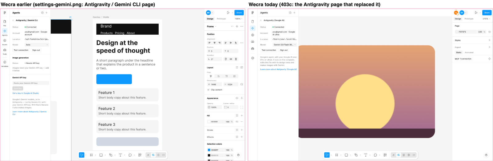

Recreated: editor-shot 403c (Antigravity's page). The "Antigravity / Gemini CLI" page with "Image generation" and
"Gemini API key" no longer exists (r13-agents-ux), so this is a successor check.

1. Minor [ours] — the Model select's value is cut ("Gemini 3.8 Flash (M…"); the old page fit "Auto". The composer's
   short names ("3.8 Flash") would fit.
2. Minor [ours] — Location is cut mid-path ("/Users/you/.local/bi…") with no way shown to read it whole.
3. Cosmetic [ours] — the same key / value grid and UI3 secondary buttons ("Test connection", "Sign out") as before.

## 3.3 A failed tool step — `agents-settings/chat-tool-error.png`

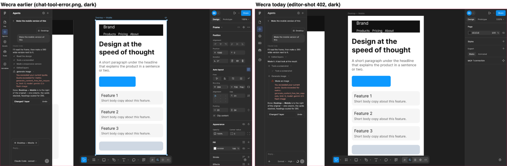

Diff: `images/agents-settings-chat-tool-error-diff.png` (12.0 %). Recreated: editor-shot 402, dark.

1. Minor [ours] — the answer's steps are grouped now (r13-chat-steps): "Edited layers ⌄", "Took a screenshot ⌃",
   "Generate image ⌃ › ⚠ Made an image ⌄"; the error still opens whole, same wording, error colour. By design.
2. Minor [ours] — after "Done" the result isn't selected any more and the composer has no "Desktop — Mobile" chip;
   the earlier shot kept the new frame selected (Design panel on its auto layout). Worth deciding which is wanted.
3. Minor [ours] — a spinning ring next to Send while nothing runs (the demo's usage ring loading) reads like a turn
   still going.
4. Cosmetic [ours] — the error is indented under its step (16 px more) and wraps into 7 lines instead of 5.

## 3.4 agents-ux close-ups (50 shots, dark + light) — regression

Recreated: editor-shot `EDITOR_ONLY=agents AGENTS_UX_DIR=…` — the same stand-in agent, the same frozen stages, both
themes. Each pair: `images/agents-ux-<name>-compare.png` (+ `-diff.png` where the crops are the same size).

| reference (dark; light alike) | changed | |
|---|---|---|
| thinking-row | crop 244 → 128 wide | 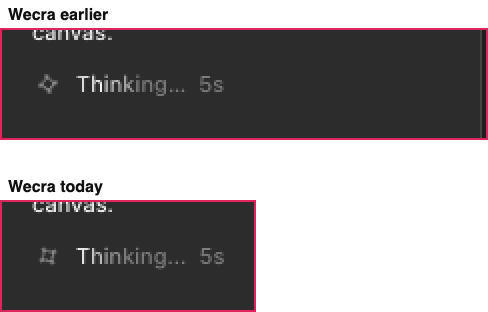 |
| chat-steps-running | 5.2 % | 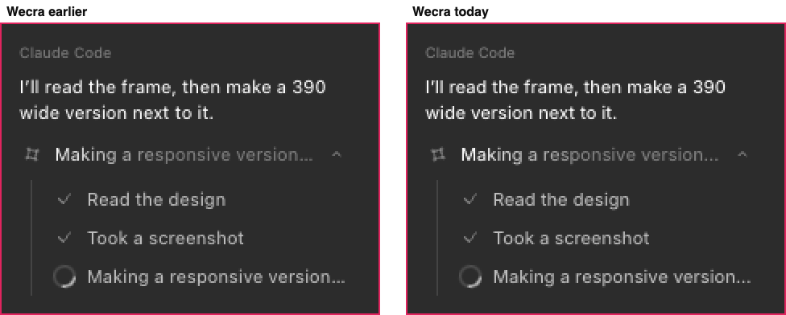 |
| chat-steps-collapsed | 8.8 % | 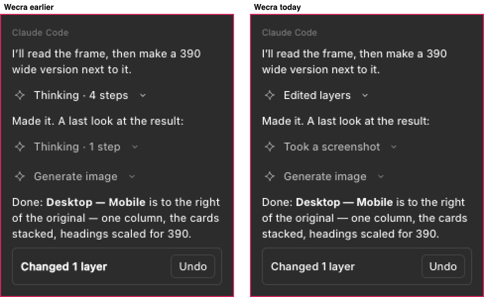 |
| chat-steps-expanded | 7.4 % | `images/agents-ux-chat-steps-expanded-dark-compare.png` |
| chat-steps-thinking | 2.8 % | 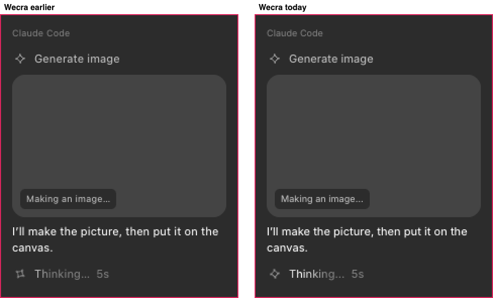 |
| chat-steps-image-making | 2.9 % | `images/agents-ux-chat-steps-image-making-dark-compare.png` |
| chat-steps-image | 2.7 % | 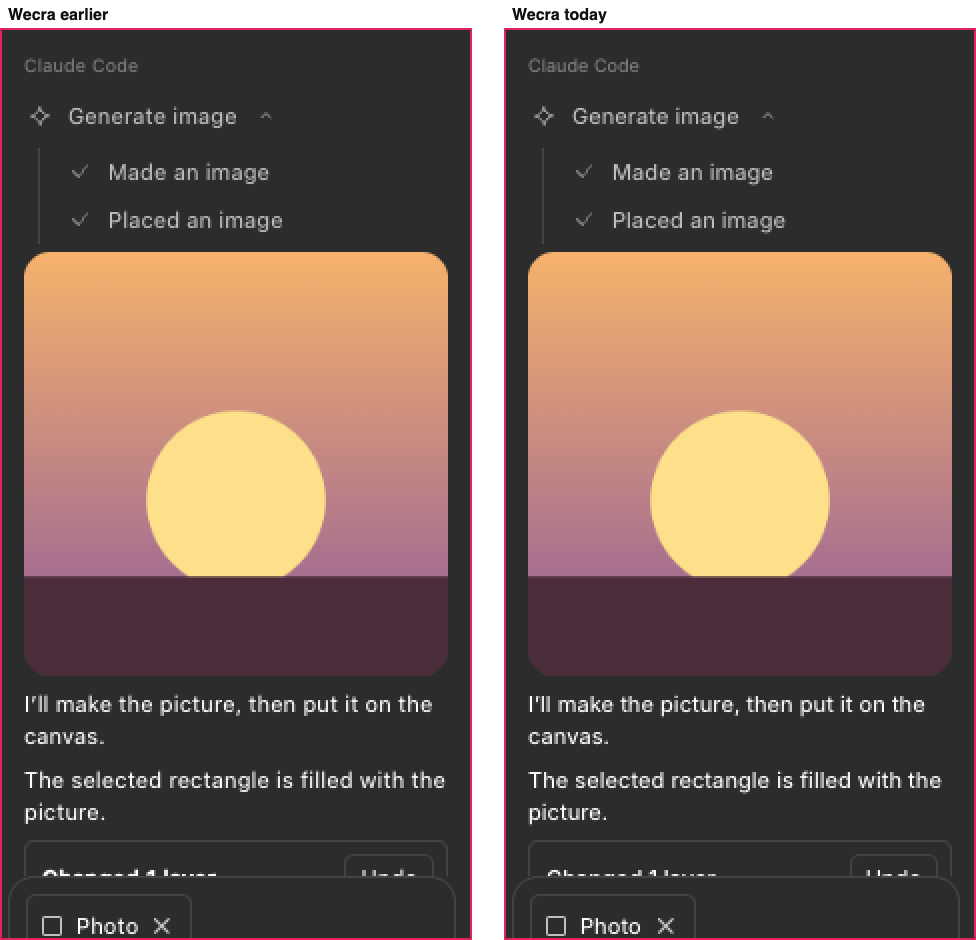 |
| chat-steps-composer | 2.7 % | 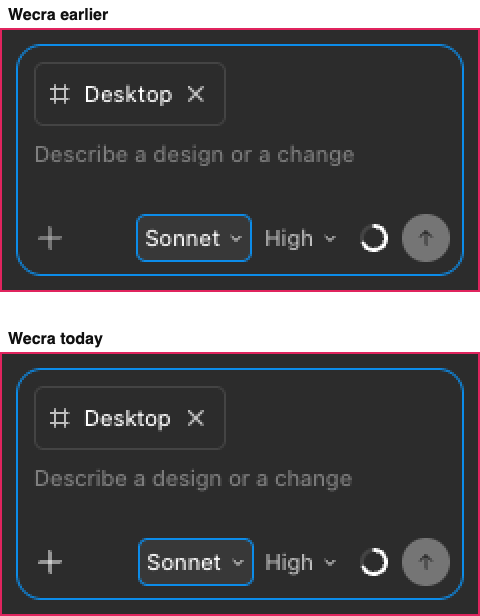 |
| image-card-making | 4.2 % | 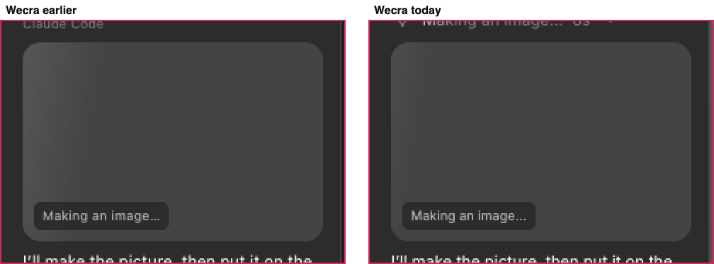 |
| image-card-revealing-sweep / -dissolve / -placed | 2.9 % | `images/agents-ux-image-card-*-compare.png` |
| canvas-placeholder-making | different size | 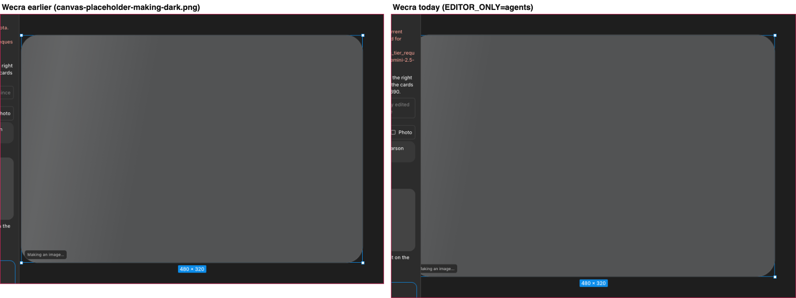 |
| canvas-placeholder-revealing-sweep / -dissolve | different size | `images/agents-ux-canvas-placeholder-revealing-*-compare.png` |
| canvas-placed | different size | 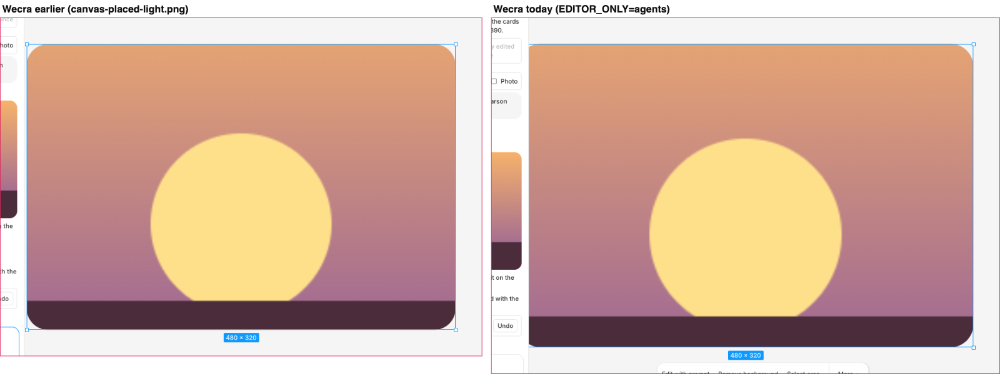 |
| composer-attachments | 274 → 242 high | 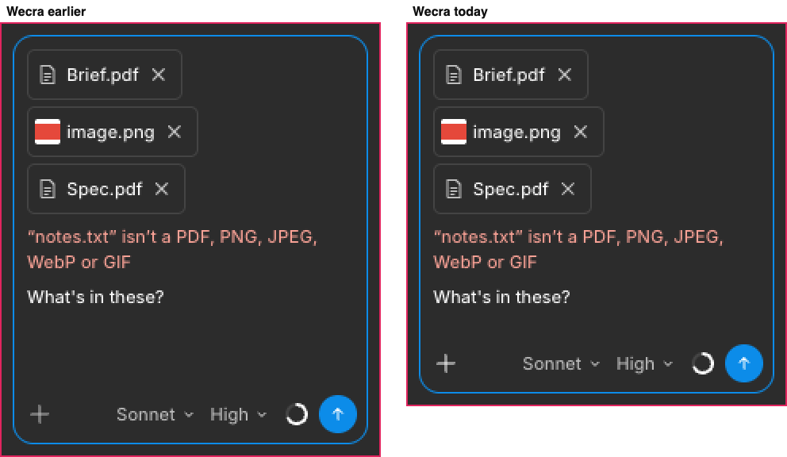 |
| composer-antigravity | 126 → 94 high | 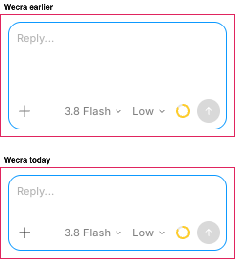 |
| composer-model-menu / -effort-menu / -sent / -usage-card | 0–0.08 % | `images/agents-ux-composer-*-compare.png` |
| chats-list | 2.4 % | 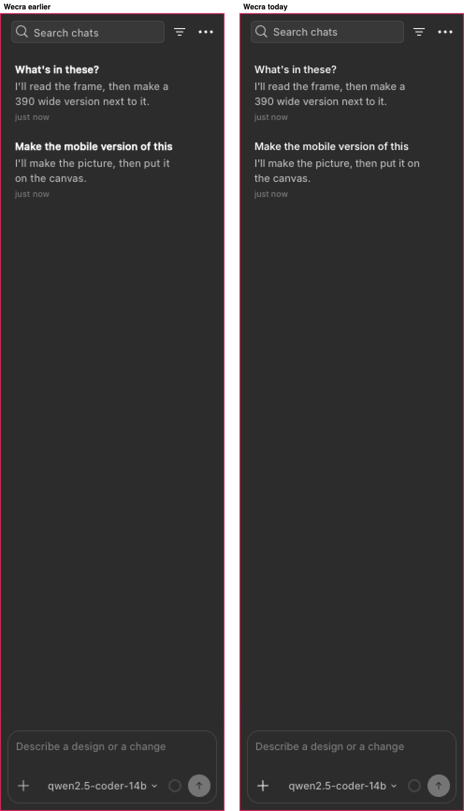 |
| chats-filter-menu | 4.2–4.7 % | 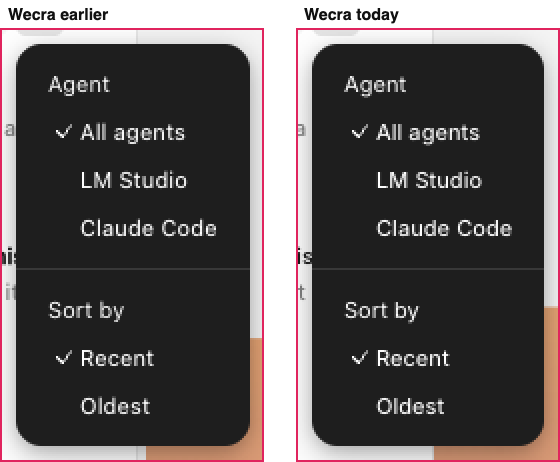 |
| chats-more-menu | 4.2–5.6 % | 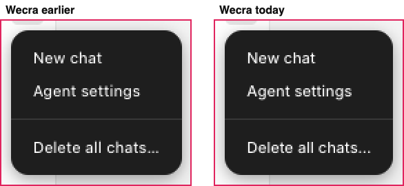 |

1. Minor [ours] — a finished group no longer sums up as "Thinking · 4 steps" / "Thinking · 1 step"; it reads its
   last step ("Edited layers", "Took a screenshot"). docs/editor.md "Steps in groups" still says "Thinking · N steps"
   — the doc or the code is out of date.
2. Minor [ours] — the composer's text box is 2 lines (32 px) where the 10-10 shots show 4, so composer-attachments
   and -antigravity are 32 px shorter. Matches r13-chat-steps ("starts at two lines"); the old shots predate it.
3. Minor [ours] — canvas placeholder / placed picture: the rectangle is drawn at a larger zoom (≈ 1.48 vs 1.43) and
   its left part lies under the left panel, cutting the "Making an image…" pill and the top-left handle; an image
   toolbar ("Edit with prompt · Remove background · Select area · More") now shows under the placed picture. The
   placeholder still covers the rectangle exactly.
4. Minor [ours] — the placed picture looks softer on the canvas than on 10-09 (the sun's edge blurred); maybe a
   lower image level drawn at this zoom — check with a real image.
5. Cosmetic [ours] — chat titles in the chats list are lighter (semibold → medium) and the preview wraps a word
   later; the Search field's text 2 px higher.
6. Cosmetic [ours] — body and menu text slightly heavier / wider throughout (as 2.1 #1); the "•••" menu 1 px narrower.
7. Cosmetic [ours] — the Thinking… row's element now hugs its text (the crop shrank from 244 to 128 px); nothing
   moves on screen. Its icon is caught at another phase of its turn (no difference).
8. (Same) the model and effort menus, the sent message with chips, the usage card — pixel-identical.

UI3 consistency notes [ours]: the image card (12 radius), chips (6), menus (13 radius, 8 px insets) and the shimmer
row follow Figma AI's look; the composer's 1 px blue focus border matches UI3 inputs' focus; the colours sampled are
tokens (panel #2C2C2C, menu #1E1E1E, the danger text).

## 3.5 Live-agent shots — `agents-ux/live-*.png` — not recreated 1:1

These are the built Electron app with the owner's own Antigravity (real turns, real limits). The web demo has neither
the desktop tab bar nor a real agent; each is set next to the demo's closest state (no diff — different shell and
data):

- `images/agents-ux-live-antigravity-sent-dark-compare.png` (vs 405a, an image asked for)
- `images/agents-ux-live-antigravity-filled-dark-compare.png` (vs 406, the picture placed)
- `images/agents-ux-live-antigravity-usage-dark-compare.png` (vs 408, the usage card)
- `images/agents-ux-live-antigravity-attachment-dark-compare.png` (vs 409, a sent message with files)
- `images/agents-ux-live-composer-pasted-file-dark-compare.png` (vs 407, chips in the composer)

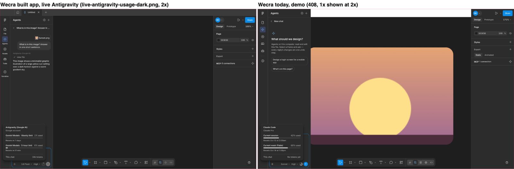

1. Cosmetic [ours] — the usage card's layout is the same (agent and plan, a bar per limit with "Resets …", "This
   chat · tokens"); the limits' names and numbers are data (Antigravity's vs the demo's Claude Code).
2. Cosmetic [ours] — the live 10-10 rail had captions; today icon-only (as 2.1 #3).

---

## Files

- `images/*-compare.png` — 93 compares; `images/*-diff.png` — 68 overlays (left out where the two differ in size,
  shell or file, where a diff would be noise).
- The capture and compositing scripts are not committed (scratch only): the shortcuts capture at 1.3228× per tab, the
  2× chrome capture, and a Playwright compositor (side by side / stacked, pink diff) — all on the repo's
  `playwright-core` and the system Chrome, no new dependency.
