# Comparison C — panels and canvas (2026-10-18)

Detection only: no product code, styles or tests were changed. Wecra is `main` at `0426c32c`, the web demo
(`vite.web.config.ts`, mode demo) on port 5212, headless Chrome 155 with SwiftShader WebGL2, 1440 × 900.

Group C's folders: `layers-polish/`, `panel17/`, `spacing15/`, `canvas-handles16/`, `canvas-nav16/`, `components15/`,
`inputs16/` (102 images).

| Kind | Images | What they were compared with |
|---|---|---|
| **Figma captures** (the owner's live Figma) | 11: `layers-polish/39.png`, `panel17/72–78.png`, `components15/figma-*.png` (3) | today's Wecra in the same state, at the captures' 2x, same theme |
| **Our own earlier screenshots** (rounds 14–17, written by `editor-shot.mjs`) | 90 (45 dark / light pairs) | **regression check**: the same `editor-shot.mjs` section run again today, which rebuilds each state and writes the same file name at the same size |

## How the states were made

- **Regression shots**: `EDITOR_URL=http://localhost:5212 EDITOR_ONLY=<section> node src/renderer/src/editor/tools/editor-shot.mjs <tmp>`
  for `layers14`, `panel17`, `spacing15`, `canvas16`, `canvasnav16`, `components15`, `inputs16`. All the sections'
  pixel checks passed today (55 + 27 + 37 + 25 + 29 + 37 + 25, no FAIL). Each image comes out the same size as the
  committed one, so every pair has a pixel diff.
- **Figma states**: a scratch Playwright script that imports the same section helpers (`layersSection`,
  `components15Section`) in a 2x context, plus its own scenes for `panel17`: frames 179 × 179 with W / H Fixed (74),
  W Hug / H Fixed (75), a child that fills both ways (76, 77 with W hovered), and a 154 × 167 frame with gap 10 and padding 0
  with the row labels on (72, 73 with W focused, 78).
- **Images**: `images/<name>-compare.png` puts the reference on the left and Wecra on the right at the same scale, with labels
  (at most 1600 px wide). `images/<name>-diff.png` shows the reference in grey with every pixel that differs by more than 40
  on any channel in red. For the Figma panels, Wecra is first moved by the best offset found within ±12 px. Where the two
  scenes differ (39, the component captures) there is no diff image. `stats.json` gives each pair's changed-pixel share,
  offset and bounding box. `images/detail-*.png` are pixel zooms used for the measurements below.
- Sizes are in CSS px (2x captures divided by 2). Colours were sampled from the PNGs.

**A setup note.** The first run showed the chrome's text heavier and different in every shot. This was a worktree
artifact, not a product change. This worktree's packages resolve from the main checkout's `node_modules`, so plain
`npm run web` answered the Inter Variable font with a 403 and the text fell back to another face. The final run used a
Vite server with the same config and mode that is also allowed to serve that folder. After that, Inter loads and the
text matches the committed shots pixel for pixel.

## Summary

| | Major | Minor | Cosmetic |
|---|---|---|---|
| Against Figma (19 distinct differences; the panel ones repeat across 72–78) | 0 | 11 | 8 |
| Regressions against our own earlier shots | 0 | 1 | 0 |
| **Total** | **0** | **12** | **8** |
| Ours, no Figma original (judged only for UI3 consistency) | 0 | 0 | 0 (4 items, all consistent) |

Most of the 90 regression images match today exactly or differ only where a change was meant to land later: the Brands
rail tab, the Social mode button, the owner's dev statuses, the round-16 radius dots, the round-17 Hug / Fill hover
chevron, and the Interaction popover's new place. The one new finding: when the pointer jumps from the canvas straight
onto the Help (?) button, the canvas hover (a gap's hatch) stays drawn.

Nothing was left without a recreation. Each Figma capture's scene content (the red "Button" with its text and icons,
`table-2` and its variants, the long Turkish layer name, the canvas rulers in 39) was stood in for by the sections'
own scenes. Differences that come only from the scene content are listed as "not a difference".

---

## Part 1 — against Figma

### 1. `layers-polish/39.png` — Layers scrolled to the end of a long name, the row selected

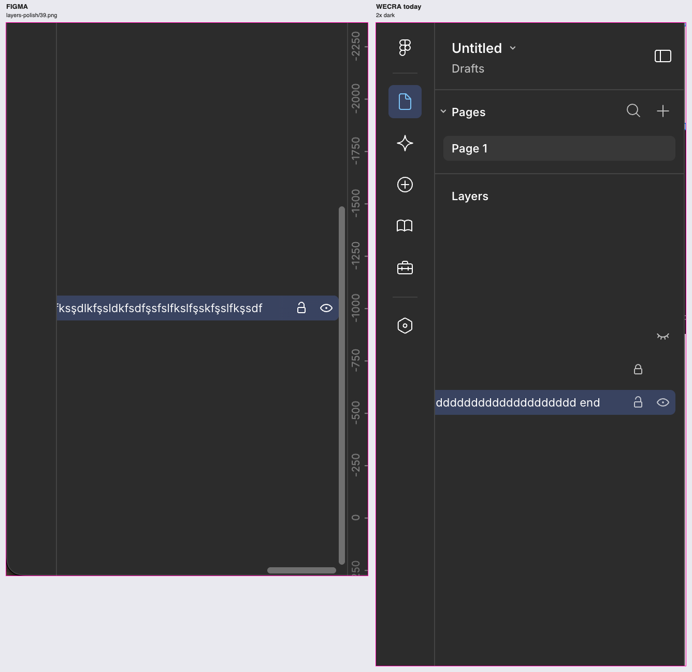

**What Figma shows.** The dark theme at 2x. The Layers list is scrolled horizontally to its end and the long-named row
is selected, so its lock and eye show. The panel's overlay scrollbars are visible, and the canvas's vertical ruler is at the right.

**Recreated.** `layersSection` at 2x dark, state `layers14-long-scrolled-end` (a long name scrolled to the end, hovered,
then clicked).

1. **Minor**: Figma shows the overlay scrollbars while the list is scrolled: a vertical thumb about 4 px wide along the
   panel's right edge and a horizontal thumb at the bottom, both mid-grey. Wecra's capture shows none, so if Wecra draws
   them, they are hidden by the time of the shot. Check by scrolling in the app.
2. **Cosmetic**: from the end of the name's ink to the lock, Figma has 33 px and Wecra 32 px. The row is 24 px high,
   the lock and eye are 24 px apart, the eye's right edge is 6 px inside the highlight, and the highlight is selected
   blue. All of these match.
3. Not a difference: the rulers (the canvas is not in the crop) and the layer's text.

### 2. `panel17/72.png` — Dimensions / Alignment / Gap with Additional labels on

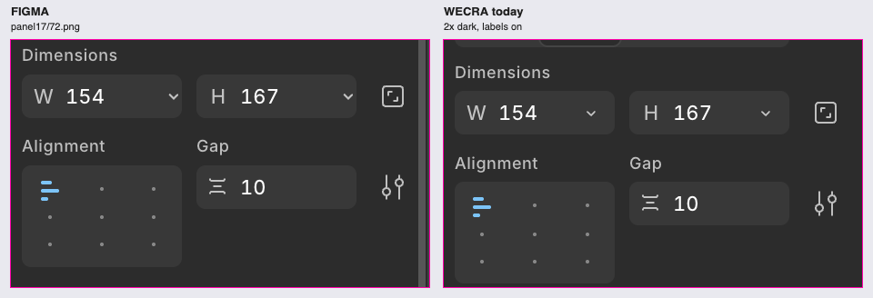 ([diff](images/figma-72-dimensions-diff.png))

**What Figma shows.** The dark theme at 2x, View › Additional labels on: W 154, H 167 (Fixed), alignment top-left, gap 10.

**Recreated.** Frame 154 × 167, gap 10, padding 0, labels on, selected.

1. **Minor**: the W / H chevron. In 72 it sits 5 px from the field's right edge (centre 81 px into an 86 px field). Wecra
   centres it 75 px into an 88 px field, 13 px from the right, which is what 74.png shows. **Figma's captures disagree**:
   72, 73 and 78 show it flush right, 74 shows it inset. Decide which one is current.
2. **Minor**: Wecra draws field values with tabular figures (`Field.module.css .tabular`), so its "1" has a foot and
   "179" is 39.4 px wide at 2x against Figma's 35 px, about 12 % wider. The glyph height is the same. Figma's digits are
   proportional. See `images/detail-74-digits.png`. This affects every numeric field.
3. **Cosmetic**: the fields are 86 px wide in this capture and 88 px in Wecra (and in 74.png). This is most likely the
   panel's width when the capture was taken.
4. These match within 1 px: the label to field gap (11), the row pitch (Dimensions field to Alignment label 39), the
   alignment box (56 high), the label and value colours, and the field fill `#383838` on `#2c2c2c`.

### 3. `panel17/73.png` — W focused, its value selected

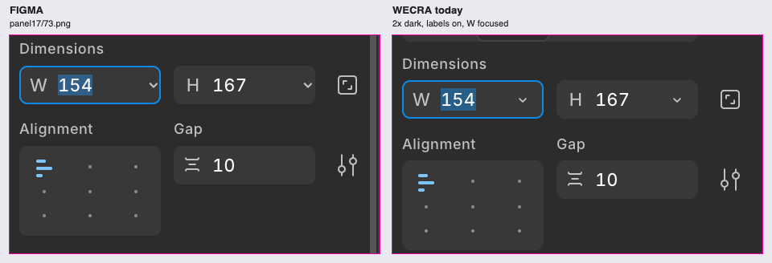 ([diff](images/figma-73-w-focused-diff.png), [zoom](images/detail-73-focus.png))

**Recreated.** The 72 state, with W clicked.

1. Same as 72's items 1–3 (chevron, tabular digits, width).
2. **Cosmetic**: the text selection behind "154" is `#275f88` in Wecra and `#325f88` in Figma.
3. Match: the focus ring is 1 px `#0c8ce9` in both, and the chevron stays visible while focused.

### 4. `panel17/74.png` — Auto layout section, labels off (W / H Fixed)

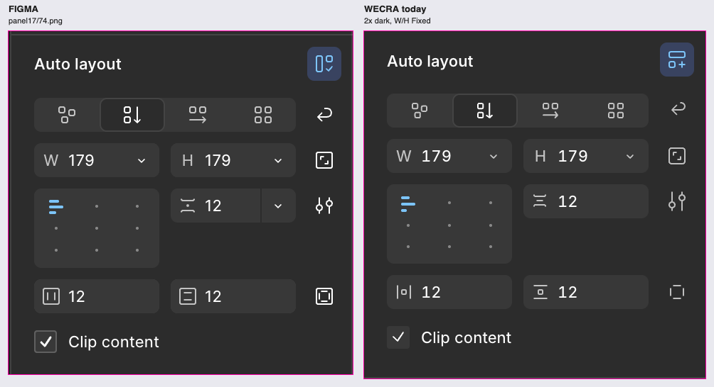 ([diff](images/figma-74-autolayout-diff.png), Wecra with the gap field
hovered: [compare](images/figma-74-autolayout-gaphover-compare.png))

**What Figma shows.** The dark theme at 2x, a vertical auto layout frame 179 × 179 with W and H Fixed, gap 12, padding 12 / 12,
and Clip content on.

**Recreated.** The same frame, labels off (today's default), with the pointer away. A second shot has the gap field hovered.

1. **Minor**: the header's auto layout button. Figma shows the "auto layout on" glyph, a tall rectangle with a small
   square and a check, on the `#394360` tile. Wecra shows a frame with a "+" (the glyph for adding auto layout) on the
   same `#394360` tile.
2. **Minor**: the gap field. Figma draws it as a split control, "12 │ ⌄", with a 1 px divider and a 24 px chevron segment,
   in 74 and 75 with no hover border visible. Wecra shows no chevron at rest; hovered, it shows a chevron inside the field
   with no divider (`images/detail-74-gap-padding.png`). In 72 / 78, Figma shows the gap field with no chevron.
3. **Cosmetic**: the gap glyph in 74 / 75 has a centre dot (≚). Wecra's glyph is the plain spacing glyph that 72 / 78 show.
4. **Cosmetic**: the padding glyphs in 74 are boxed: a rounded square with two vertical bars, and one with top and bottom
   bars. Wecra uses the bracket glyphs (|▫| and ‾▫_) that Figma's 78 shows. Figma uses both sets.
5. **Minor**: the independent-paddings button. In 74 it is a solid square-in-square glyph at full white. Wecra's is the
   dashed-corner glyph in grey, which is what Figma's 78 shows.
6. **Minor**: the Clip content checkbox. Figma draws a 16 px box with a 1 px `#606060` border, the `#383838` fill, and a
   heavier (about 1.5 px) white check. Wecra's box has the same fill, no border, and a thinner 1 px check
   (`images/detail-74-checkbox.png`).
7. **Cosmetic**: from the "Auto layout" title to the Flow row, Figma has 24 px and Wecra 23 px. The rows are 32 px apart
   in both (Flow → W / H → alignment / gap → padding → Clip content).
8. Same as 72's item 2 (tabular digits).
9. Match: the backgrounds `#2c2c2c` / `#383838`, the W chevron at 75 px, the field and button sizes, the
   alignment grid, and the title's weight and size.

### 5. `panel17/75.png` — W Hug, H Fixed

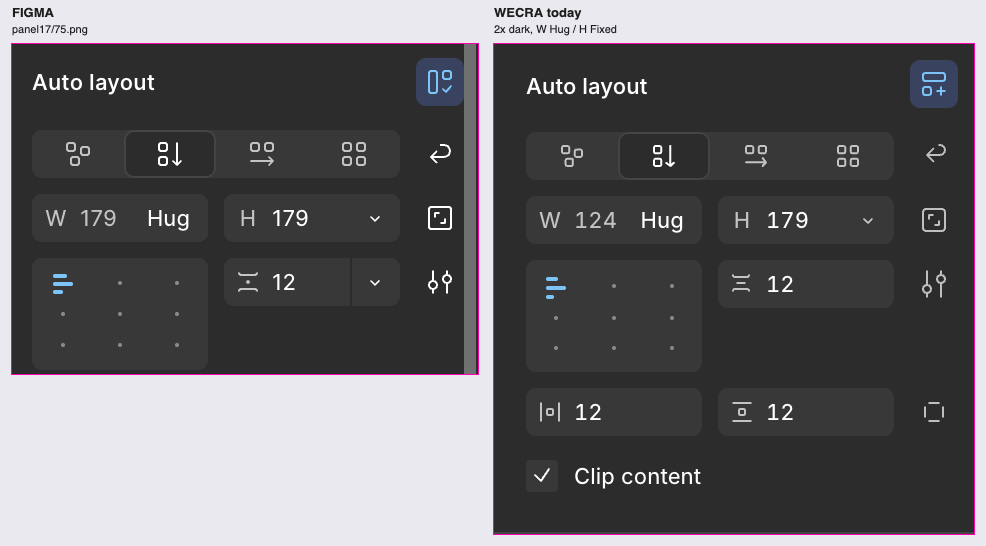 ([diff](images/figma-75-w-hug-diff.png))

**Recreated.** A vertical frame with W Hug (counter axis) and H Fixed. Its hugged width is 124 against Figma's 179;
that is the scene, not a difference.

1. Same as 74's items 1 (header glyph), 2 (gap split chevron) and 3 (gap glyph), and 72's item 2 (digits).
2. Match: the grey number, "Hug" in the text colour at the field's right, no chevron at rest, and H with its chevron.

### 6. `panel17/76.png` — a layer filling both ways

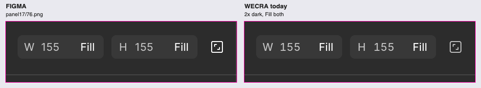 ([diff](images/figma-76-fill-both-diff.png))

**Recreated.** A rectangle that fills both ways in a fixed auto layout frame, selected, with the pointer away.

1. Only 72's item 2 (digits). The fields, the grey numbers, "Fill" and its 9 px inset, and the aspect-ratio button
   match (1.6 % of pixels differ, all in glyphs).

### 7. `panel17/77.png` — the same layer with W hovered

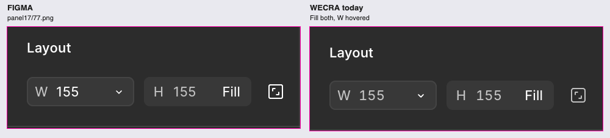 ([diff](images/figma-77-fill-w-hover-diff.png))

**Recreated.** As 76, with the pointer on W.

1. Only 72's item 2 (digits). The hover border is `#444444` in both, the W number turns white with the chevron in "Fill"'s
   place, and H keeps "Fill". All of this matches.

### 8. `panel17/78.png` — the whole section with labels on

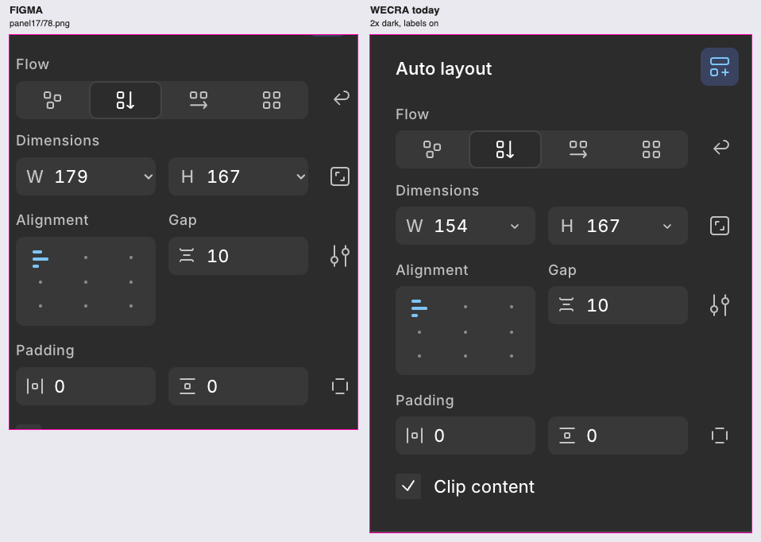

**Recreated.** As 72, the whole section. Figma's frame is 179 wide and the recreation 154; that is the scene.

1. Same as 72's item 1 (the chevron is flush right in 78) and item 2 (digits).
2. Match: the Flow / Dimensions / Alignment / Gap / Padding labels and their places, the padding glyphs, the
   independent-paddings glyph, and the row pitch.

### 9. `components15/figma-instance-child-hover.png` (46) — an instance hovered at its cut-off corner

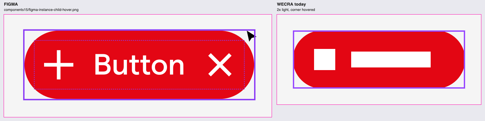

**What Figma shows.** The light canvas `#f5f5f5` at 2x, nothing selected, the pointer at the pill instance's top-right
corner, outside its rounded shape.

**Recreated.** The components15 scene, 2x light: a 260 × 88 pill instance, radius 44, with a "Content" auto-layout
child, nothing selected, the pointer at (257, 3) of the instance.

1. **Minor**: Figma also outlines the instance's inner auto-layout frame (Content) with a dotted purple line while the
   instance is hovered. Wecra draws only the instance's outline.
2. **Minor**: on the light canvas, the component purple is `#8a38f5` in Figma and `#9747ff` in Wecra. The outline is
   2 px in both.
3. Not a difference: the instance's content ("+ Button ×" against two white bars), and the cursor.

### 10. `components15/figma-instance-child-selected.png` (45) — the layer inside the instance selected

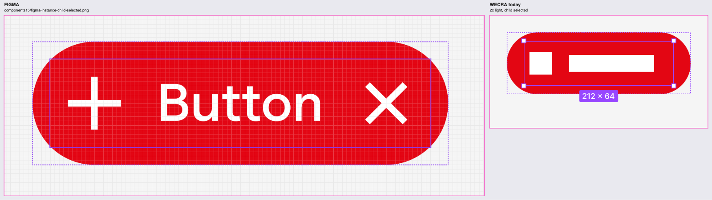

**Recreated.** The components15 state `instance-child-selected` at 2x light, after a second click on the label, which
selects Content.

1. **Minor (check in Figma)**: in Figma's capture, the selected layer has a plain 1 px purple box with no corner handles
   and no size badge. Wecra draws four handles and the "212 × 64" badge. The capture may have been taken mid-gesture;
   check this in Figma before treating it as a rule.
2. **Minor**: the purple is `#8a38f5` in Figma and `#9747ff` in Wecra (the same issue as 9.2).
3. Match: the instance is dashed purple around the selected layer, and the layer's box is solid.
4. Not recreated: the zoom. Figma's capture is zoomed in far enough that the pixel grid shows; Wecra was at 100 %. The
   grid and the scale are therefore not a difference.

### 11. `components15/figma-layers-component-set.png` (44) — a component set's rows in Layers

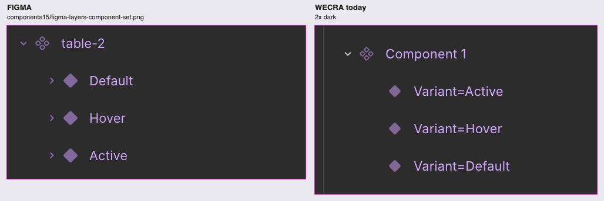

**Recreated.** The components15 Layers crop at 2x dark: a set made with Combine as variants, opened.

1. **Minor**: the variant glyph (a filled diamond) is 12 px in Figma and 10 px in Wecra.
2. **Minor (check)**: Figma's rows read the value only ("Default", "Hover", "Active"). Wecra shows the layer's full name
   ("Variant=Default"). This may be the capture file's own layer names, so check in Figma whether UI3 drops the
   `Property=` part.
3. **Cosmetic**: the diamond is `#80699b` in Figma and `#7e6a96` in Wecra. The names match: `#d2a8ff` against `#d1a8ff`.
4. Match: the chevron, glyph and name steps (16 px each), the variant indent (24 px), the set's four-diamond glyph, and the
   row pitch (32 px).
5. Not a difference: the variants' expand chevrons (Figma's variants have children), their order, and the names
   `table-2` / `Component 1`.

---

## Part 2 — regression check against our own earlier screenshots

The reference is the committed shot, which is the same tool's output from its round. Unless a row says otherwise, dark
and light behave the same. Rows at 0 % are pixel-identical.

### `layers-polish/` (round 14) — 20 images

| Reference | Changed | Verdict |
|---|---|---|
| `layers14-rail` | 2.05 % | Ours: the **Brands** tab (book glyph) was added between Assets and Tools, so Tools and Variables sit 40 px lower ([compare](images/layers14-rail-dark-compare.png)) |
| `layers14-rows`, `-fade`, `-fade-hover`, `-width-fits`, `-vscroll`, `-long-scrolled-end`, `-deep-scrolled-0`, `-deep-revealed` | 0.23 % | Only the rail, as above. The list, its rows, fades, indents, lock and eye are pixel-identical |
| `layers14-deep-scrolled-end` | 0.29 % dark / 0.63 % light | The rail, and a "Frame" tooltip under the pointer on a row's glyph ([compare](images/layers14-deep-scrolled-end-light-compare.png)). That tooltip has existed since 2026-10-09 (`LayerRow.tsx`); it shows only because of the run's timing. Not a regression |

### `panel17/` (round 17) — 12 images

| Reference | Changed | Verdict |
|---|---|---|
| `panel17-autolayout`, `-layout-fill`, `-w-fixed-hover`, `-w-focused` | 0 % | identical |
| `panel17-h-hug-hover` | 0.82 % | Intended: hovered, H Hug now shows the chevron in place of "Hug" (the owner's 2026-10-10 correction, which the section checks; the committed shot predates it) ([compare](images/panel17-h-hug-hover-dark-compare.png)) |
| `panel17-fill-hover` | 0.58 % | Intended, the same rule for "Fill" ([compare](images/panel17-fill-hover-dark-compare.png)) |

### `spacing15/` (round 15) — 14 images

| Reference | Changed | Verdict |
|---|---|---|
| `spacing15-padding-drag`, `-gap-drag` | 0 % | identical |
| `spacing15-padding-hatch`, `-padding-bar`, `-gap-bar` | 0.09 % | Intended (round 16): the frame's four radius rings show while it is hovered ([compare](images/spacing15-padding-bar-light-compare.png)) |
| `spacing15-dev-tooltip` | 3.6 % / 5.6 % | Ours: the frame-title button's tooltip reads "Set status" in place of Figma's "Mark as ready for dev" (the owner's statuses, docs/editor.md) ([compare](images/spacing15-dev-tooltip-light-compare.png)) |
| `spacing15-ready` | 3.8 % / 3.6 % | Ours: once marked, the green `</>` badge became the green "Ready to Dev" status chip ([compare](images/spacing15-ready-dark-compare.png)) |

### `canvas-handles16/` (round 16) — 14 images

| Reference | Changed | Verdict |
|---|---|---|
| `canvas16-padding`, `-padding-alt`, `-gaps`, `-frame-clip` | 0 % | identical |
| `canvas16-panel-highlight` | 1.09 % | Shot-script artifact plus one finding, below ([compare](images/canvas16-panel-highlight-dark-compare.png), [diff](images/canvas16-panel-highlight-dark-diff.png)) |
| `canvas16-radius-inverted`, `-radius-one-inverted` | 0.26 % | Shot-script artifact: today the radius rings are missing because the pointer is not over the shape ([compare](images/canvas16-radius-inverted-dark-compare.png)). The inverted corners themselves are pixel-identical |

**What happened.** The section's "pointer away" jumps the mouse in one move to (1410, 870). Today that point is the
right panel's Help (?) button. Probing the state (`images/detail-canvas16-hover-after-away.png`) shows:

- the Design panel's highlight alone hatches only the bottom padding, which is correct;
- moving the pointer to empty canvas, or through either panel in steps, clears every hover;
- the radius rings show while the pointer is over the frame, which matches `docs/engine.md` ("a selected rectangle
  under the pointer").

That leaves one finding:

1. **Minor (behaviour, edge case)**: if the pointer jumps straight from a gap onto the Help (?) button, the gap's hatch
   and its bars stay drawn. In round 16 the same jump cleared it. A real mouse rarely jumps like that, but a pointer
   leaving the canvas onto that floating button should end the hover, as Figma's does.

### `canvas-nav16/` (round 16) — 12 images

| Reference | Changed | Verdict |
|---|---|---|
| `canvasnav16-nub-hover`, `-nub-left`, `-nub-bottom` | 0 % | identical |
| `canvasnav16-scrollbars`, `-nub-drag` | 0.3–0.5 % | Ours: the toolbar's mode group has a **Social** button (Draw │ Design │ Social │ Motion │ Dev Mode). The scrollbars, the nub and the drag line are identical ([compare](images/canvasnav16-scrollbars-dark-compare.png)) |
| `canvasnav16-connection` | 0.5 % | The toolbar, as above. Also, after a drag connects, the **Interaction** popover now opens docked against the right panel (x 958–1200 at 1440 wide, `images/detail-canvasnav16-connection-full.png`) instead of over the canvas near the frame, so it has left the 480 px crop. This is where Figma puts interaction details, beside the right panel, so it is not a regression |

### `components15/` (round 15) — 10 images

| Reference | Changed | Verdict |
|---|---|---|
| `components15-component-set`, `-instance-child-selected`, `-layers` | 0 % | identical |
| `components15-instance-selected`, `-instance-child-hover` | 0.2 / 0.4 % | Intended (round 16): the pill instance's radius rings, at its 44 px radius inside the pill. Its padding bars now have a white edge, the same as the blue frames' bars ([compare](images/components15-instance-child-hover-dark-compare.png)) |

### `inputs16/` (round 16) — 8 images

| Reference | Changed | Verdict |
|---|---|---|
| `inputs16-hover-horizontal-canvas`, `-apply-variable-inside` | 0 % | identical |
| `inputs16-padding-pair`, `-padding-merged` | 0.1–0.2 % | Intended (round 17): only the half-cropped W / H row at the top changed. H Hug now reads a grey "111" and "Hug" with no chevron. The padding fields ("18, 22, 17, 19") are identical ([compare](images/inputs16-padding-merged-light-compare.png)) |

---

## Ours — no Figma original

Judged only for consistency with Figma's UI3 language. They are not counted as differences from Figma.

1. **Brands rail tab** (book glyph, `layers14-rail`): consistent. It uses the same 32 px tile with 8 px around it, the
   same 1 px line glyph, the same hover and selection tiles, and a tooltip with its shortcut. No issue.
2. **Social mode button** in the toolbar's mode group (`canvasnav16-*`): consistent. It has the group's 24 px button,
   the glyph weight and spacing, and the same grey at rest. No issue.
3. **"Set status" tooltip** on the frame-title `</>` button (`spacing15-dev-tooltip`): it uses the DS Tooltip with Figma's
   look (dark pill, 11 px, arrow) and placement. Only the wording departs from Figma, by design. No issue.
4. **"Ready to Dev" status chip** (`spacing15-ready`): a filled green pill with 11 px white text and 6 px padding. It is
   consistent with Figma's own "Ready for dev" chip; the label and the per-status colours are the owner's. No issue.

## Files

- `images/*-compare.png` (102): reference left, Wecra right.
- `images/*-diff.png` (97): one for every pair except 39, 78 and the three component captures, whose scenes don't
  overlay.
- `images/detail-*.png` (6): the zooms and probes referred to above.
- `stats.json`: each pair's changed-pixel share, offset and bounding box.
